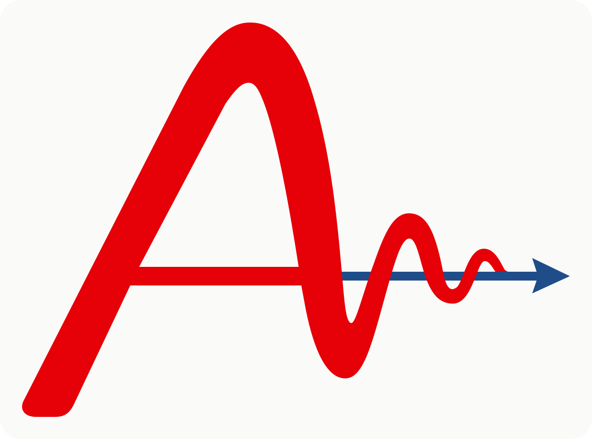

# Asymmetry <br clear="right">

Asymmetry is a Python library for reducing, fitting, and visualising muon-spin spectroscopy (μSR) data. You can use it through the desktop application, from the command line, or directly in Python.

[](https://www.python.org/downloads/) [](https://github.com/BenHuddart/asymmetry/blob/main/LICENSE)

**[Download the desktop application](https://github.com/BenHuddart/asymmetry/releases/latest)** for
**Windows x64** or **macOS on Apple Silicon**.

To open your own data in the desktop application, choose **File → Open Data File(s)…**.
Asymmetry reads supported ISIS NeXus, PSI BIN/MDU, and MusrRoot/LEM ROOT acquisitions,
including multi-period ISIS runs. The
[loading guide](https://benhuddart.github.io/asymmetry/reference/loading_data.html)
lists supported layouts and required readers.

[Documentation](https://benhuddart.github.io/asymmetry/) ·
[Issue tracker](https://github.com/BenHuddart/asymmetry/issues) ·
[Changelog](https://github.com/BenHuddart/asymmetry/blob/main/CHANGELOG.md)

## Installation

### Desktop application

[Download the latest release](https://github.com/BenHuddart/asymmetry/releases/latest) for
**Windows x64** or **macOS on Apple Silicon**. The installer includes Python and the GUI
dependencies. Open Asymmetry from the Windows Start menu or the macOS Applications folder.
Linux and Intel Mac users can use a Python installation.

### Python installation

Asymmetry requires Python 3.11 or later; clean installations are checked on Python 3.11,
3.12, and 3.13. Use a virtual environment as described in the
[installation guide](https://benhuddart.github.io/asymmetry/getting_started/installation.html).
For a version published on PyPI, install the full end-user Python feature set and launch:

```bash
python -m pip install "asymmetry[all]"
asymmetry-gui
```

If the version you need is not available on PyPI, use the
[source installation](https://benhuddart.github.io/asymmetry/getting_started/installation.html#source-installation).
The core library and CLI can also be installed on their own:

```bash
python -m pip install asymmetry
```

Extras select additional Python dependencies and can be combined:

```bash
python -m pip install "asymmetry[gui,hdf5,root]"
```

| Extra | Provides |
|---|---|
| `all` | GUI, file readers, headless plots, and GLE support; excludes development tools and CUDA |
| `gui` | Desktop interface and Matplotlib |
| `agent` | Headless plots and HDF5 loading for CLI/agent workflows |
| `hdf5` | HDF5 NeXus reading and writing |
| `hdf4` | Legacy HDF4 NeXus reading |
| `root` | Supported μSR ROOT file reading |
| `gle` | GLE script generation |
| `gpu` | Optional CUDA acceleration for MaxEnt |
| `dev` | Contributor tools for testing, lint, and documentation |

HDF4 can require native libraries, and compiling GLE scripts requires the external GLE
program. GPU use requires compatible NVIDIA hardware and drivers. See the
[installation guide](https://benhuddart.github.io/asymmetry/getting_started/installation.html#external-programs-and-runtimes)
for platform requirements. The desktop installers bundle their HDF4 runtime.

## Getting started

The desktop [Quickstart](https://benhuddart.github.io/asymmetry/getting_started/quickstart.html)
shows how to load and fit a public ISIS copper run, reopen the saved project, and export the
fit report.

The Python [API cookbook](https://benhuddart.github.io/asymmetry/reference/cookbook.html)
covers loading, calibration, reduction, and fitting, with a self-contained
[array fit](https://benhuddart.github.io/asymmetry/reference/cookbook.html#cookbook-fit-arrays)
that runs with the core installation.

### Use the CLI or an AI coding agent

The `asymmetry` CLI supports JSON output and headless plots. For a published release,
install the CLI and the packaged skill for Claude Code or Codex with pipx.

```bash
pipx install "asymmetry[agent]"
asymmetry --help
asymmetry skill install --agent claude  # or --agent codex
asymmetry skill check
```

Restart the agent after installing or upgrading its skill. After upgrading Asymmetry, rerun
`asymmetry skill install` and `asymmetry skill check`. Add `hdf4` or `root` to the extras when
your files require them. The desktop installer does not put this CLI on `PATH`.
See the [CLI and agent guide](https://benhuddart.github.io/asymmetry/reference/agent_workflow.html)
for source installation, skill management, and analysis commands.

## Overview

- **Reduction and calibration.** Select detector groups, estimate detector balance, apply
  timing, deadtime, and background settings, and rebin or combine compatible data.
- **Fitting.** Fit time- and frequency-domain signals, raw detector counts, multiple detector
  groups, or simultaneous run series using built-in models and composite expressions.
- **Spectra.** Compute Fourier spectra with windowing and phase controls, or reconstruct
  spectra with a maximum-entropy solver.
- **Scans and trends.** Analyse integral field and RF scans, compare fitted parameters across
  runs, and fit parameter trends with physical models.
- **Simulation.** Generate synthetic detector counts for teaching and checking an analysis
  with known inputs and recorded random seeds.
- **Projects and export.** Save and reopen analysis sessions with their settings and provenance,
  and export plot data, figures, and GLE scripts.

## Project status and validation

**Asymmetry is beta software under active development.** AI coding agents (Claude Code and
Codex) have written its code and documentation. APIs may change between releases. Projects
saved by released versions remain loadable.

Automated tests, independent mathematical references, and comparisons with established μSR
software check numerical behaviour. The
[numerical accuracy guide](https://benhuddart.github.io/asymmetry/explanation/numerical_accuracy.html)
explains the evaluation targets and their scientific scope. The
[software comparisons](https://benhuddart.github.io/asymmetry/explanation/comparison.html)
describe tested cases, agreement, and known limitations.

Check scientific claims and model definitions against primary literature and other trusted
sources, and validate results for your analysis before relying on them for publication.

## Documentation and support

- [Worked analyses](https://benhuddart.github.io/asymmetry/workflows/index.html)
  and [feature reference](https://benhuddart.github.io/asymmetry/reference/index.html)
- [Python API reference](https://benhuddart.github.io/asymmetry/api/index.html)
- [Report an issue](https://github.com/BenHuddart/asymmetry/issues)
  or [contribute](https://github.com/BenHuddart/asymmetry/blob/main/CONTRIBUTING.md)

Asymmetry is maintained by Ben Huddart. Models and file formats are implemented from
published mathematics, documented formats, and observed behaviour. We acknowledge the work
behind WiMDA, musrfit, and Mantid; see
[NOTICE](https://github.com/BenHuddart/asymmetry/blob/main/NOTICE) for attribution and the
[MIT licence](https://github.com/BenHuddart/asymmetry/blob/main/LICENSE) for Asymmetry's terms.
