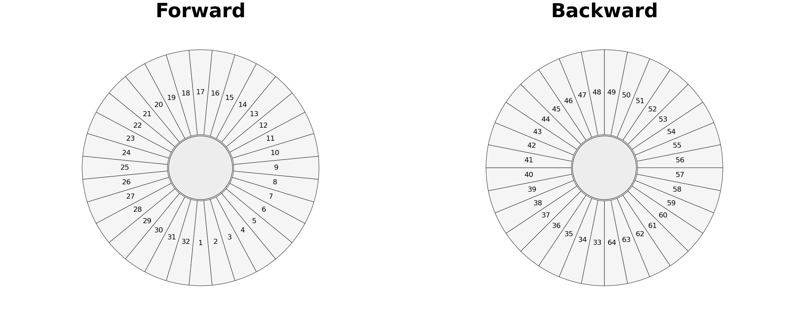
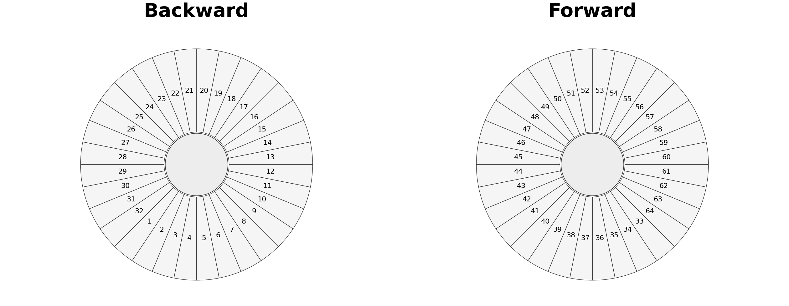
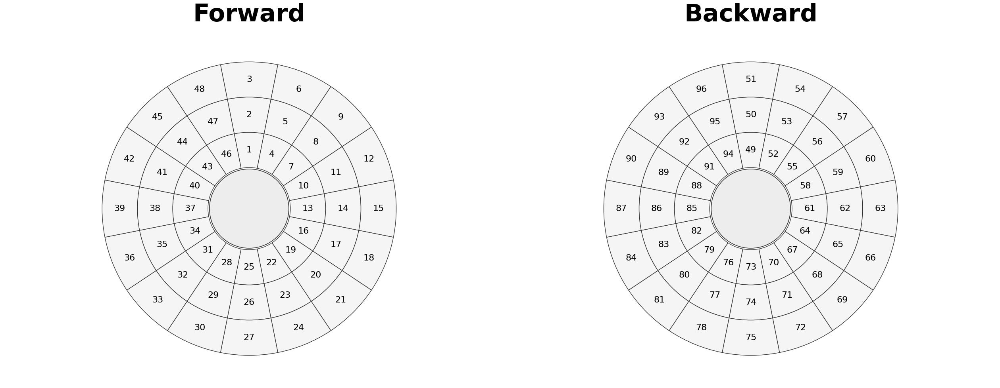
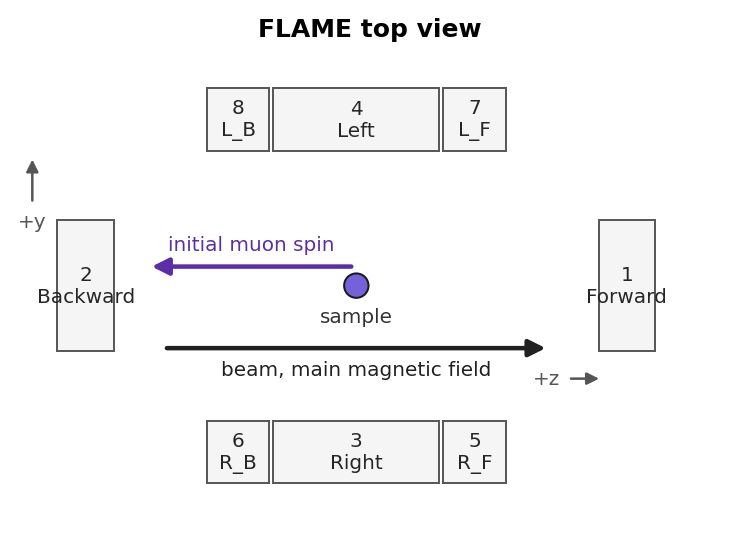
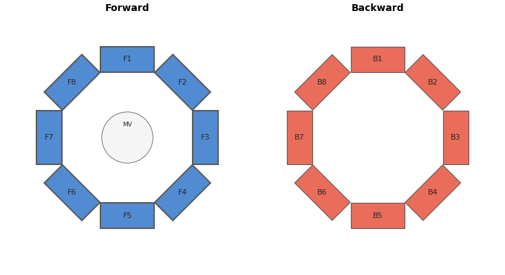
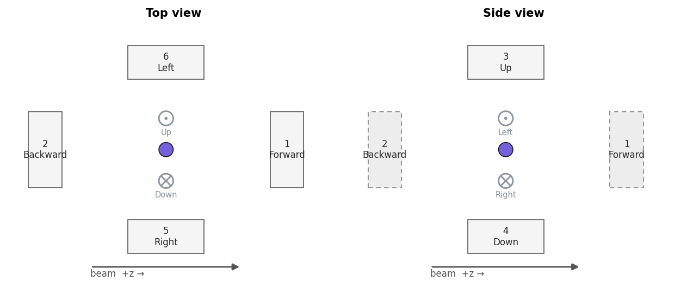

Detector Grouping and Layout
============================

For the operation order and calibration dependencies, see
:doc:`/explanation/reduction_pipeline`.

Detector grouping defines how the raw per-detector count histograms are
combined into the forward and backward sums that enter the asymmetry
formula. The choice is dictated by the experiment: a coarse two-group
arrangement is right for ordinary asymmetry analysis on a longitudinal
spectrometer; keeping detectors as individual groups is what enables the
per-detector amplitudes and phases needed for a paramagnetic Knight-shift
measurement (:doc:`grouped_time_domain_fitting`); and a vector-polarisation
experiment needs distinct pairs assigned to :math:`P_x`, :math:`P_y`, and
:math:`P_z` (:doc:`vector_polarization`). For new data from any of the
supported instruments — ISIS HiFi, MuSR, EMU and the PSI FLAME, HAL-9500 and
GPS spectrometers — the matching preset in the Detector Layout editor seeds
sensible defaults that can then be refined graphically before being applied.
Data from any other instrument is grouped by typing detector lists into the
Grouping window's table, or by clicking a generic ring of its detectors (see
`Instruments without a layout`_).

Grouping is configured from the **Grouping** window and edited graphically
with the **Detector Layout** editor. This page covers both, together with the
grouping-profile model that stores the settings, the per-format (PSI/ROOT)
details, and the beam-vs-analysis naming conventions. For a hands-on
walkthrough with a worked calibration, see :doc:`grouping_calibration`.

Grouping profiles
------------------

A grouping profile is a **named, project-level record of the shareable
grouping settings for one instrument** — the detector groups, which pair
is forward/backward, the :math:`\alpha` policy, and the deadtime, background,
binning and period settings. It excludes anything that is a fact about an
individual run rather than a shared analysis choice: :math:`t_0`, the
good-bin window, per-detector deadtime read from a file, and period tables
stay with the run.

The scripting profile holds a single
:class:`~asymmetry.core.transform.rebin.BinningSpec` in ``profile.binning``.
It describes base bins with ``merge=1``; display and CLI merges compose with
those bins. A profile constructed with a different merge raises
``Grouping profiles store base binning; merge must be 1.`` The saved grouping
keys remain ``binning_mode``, ``bunching_factor``, ``bin0_us`` and ``bin10_us``.

This split solves a real problem. Every run used to carry its own complete
grouping payload, so recalibrating :math:`\alpha` after loading a fifth run
in a series meant editing it a fifth time — and nothing stopped two runs of
the same series from silently drifting apart. A profile fixes the shareable
choices in one place: edit it once, and every run that matches it is
analysed the same way.

Instrument and scope
~~~~~~~~~~~~~~~~~~~~~~

A profile applies to every run of one **instrument** — matched, internally, on
the pair ``(instrument, histogram count)``. The histogram count disambiguates
layout variants of the same physical instrument, such as PSI GPS's
six-detector PSI-BIN export and its eleven- and fifteen-detector MusrRoot
exports (see `PSI GPS`_ below): all are shown as one instrument, but a GPS
PSI-BIN profile is never offered to an eleven-detector GPS ROOT run. The window
names the instrument plainly — "GPS" — and appends the detector count only when
several variants of the same instrument are loaded together, so they can be told
apart: "GPS (6 detectors)", "GPS (11 detectors)", "GPS (15 detectors)".

A project may hold several profiles per instrument **in concurrent use** —
the typical case is one profile per sample, each with its own background,
:math:`\alpha`, and deadtime settings, kept in one project so the samples can
be compared side by side. Every run records which profile it is **assigned**
to and follows that profile; editing a profile reaches exactly the runs
assigned to it and leaves the other profiles' runs alone. One profile per
instrument is flagged the **default for new runs** (marked ★ in the Grouping
window's profile selector): a newly loaded run is assigned to it
automatically — no per-run Apply step is needed — and can then be reassigned
to another profile, from the Grouping window's scope panel or the Data
Browser's **Assign Grouping Profile** context menu (`Assigning runs to
profiles`_ below).

Because a run's instrument is a fact about its data rather than a user
preference, a **stale persisted instrument identity self-heals on reload**: if a
project saved the wrong instrument for a run (for example, a FLAME run stored as
"GPS" by an older version), re-detection from the freshly loaded file overrides
the stored value, the run is re-matched to the correct instrument's profile (or
kept on the loader defaults if none exists), and the mismatched preset's group
names are discarded. Saved profiles themselves are never altered — only runs
heal.

A run can be explicitly **released** from its profile, freezing its current
grouping as a per-run override that further profile edits do not touch. The
Data Browser marks a released run with a trailing **⊗** and the tooltip
"Custom grouping — this run is released from its grouping profile (based on
'<profile>')." — the named profile is the run's **base**, the one it stays
assigned to while released. A released run can later be **reattached**,
dropping the override so it follows its base profile again. Release and
reattach are both driven from the Grouping window's scope panel (`The
Grouping window`_ below).

.. _Assigning runs to profiles:

Assigning runs to profiles
~~~~~~~~~~~~~~~~~~~~~~~~~~~~

Which profile a run follows is an explicit, per-run **assignment**. It can be
changed in two places, and both apply the target profile's settings to the
moved runs immediately:

* **Grouping window** — select runs in the scope panel and press
  **Assign to ▸**, which lists every profile of the instrument. Assigning a
  *released* run does not drop its override; it only retargets the base
  profile that Reattach returns it to.
* **Data Browser** — select any number of runs and choose **Assign Grouping
  Profile** from the context menu; the runs' current profile is checked. The
  submenu appears once the selected runs' instrument has at least two
  profiles.

Every **non-default** profile of a multi-profile instrument carries its own
**identity colour**, assigned from a fixed palette when the profile is first
saved and stored with it in the project; the ★ default profile stays
uncoloured, so its runs keep plain black run numbers and a coloured run
number always means "assigned off the default". The colour is worn
consistently everywhere the profile appears: the Data Browser colours each
run's number with its assigned profile's colour (with the tooltip "Grouping
profile: <name>" naming it), the Grouping window's scope rows, editing
strip, and selector swatches use the same colour, and a released run shows
amber instead — the diverged state outranks sample identity. A multi-sample
project therefore reads as a colour-coded sample map; single-profile
projects stay entirely uncoloured.

Alpha, deadtime, and background policies
~~~~~~~~~~~~~~~~~~~~~~~~~~~~~~~~~~~~~~~~~

A profile stores each of its three corrections as a **policy** — a mode plus
whatever value the mode needs — rather than a bare value, so the provenance
of the number survives:

* **Alpha policy** — ``fixed`` applies the same value to every run;
  ``calibrated`` applies a value measured once (with a recorded method and
  source run, e.g. "diamagnetic · run 2923"); ``per_run_estimate`` computes
  each run's own forward/backward integral ratio at resolution time (Mantid's
  ``AlphaCalc`` convention). It uses the current effective pair, exclusions,
  selected Red or Green period, good window and corrected counts. This is an
  explicit policy, independent of the one-shot **Estimate** method.
* **Beta** — the intrinsic-asymmetry balance :math:`\beta = A_{0,b}/A_{0,f}`
  (musrfit's asymmetry-fit companion to :math:`\alpha`), applied with
  :math:`\alpha` in the asymmetry formula
  :math:`A = (F - \alpha B)/(\beta F + \alpha B)`. The default 1 is the
  standard formula and is omitted from saved profiles, so existing projects
  are unaffected. Unlike :math:`\alpha`, :math:`\beta` is invisible to
  integrated counts, so no count ratio can measure it; it is either entered
  as a fixed scalar or measured from a weak-TF calibration run's precession
  fit (``calibrated`` mode, with recorded method and source run, mirroring
  the :math:`\alpha` policy) — see :doc:`data_reduction/beta_calibration`.
* **Deadtime policy** — ``off`` disables the correction; ``from_file`` reads
  each run's own file deadtime values; ``manual`` applies a stored
  per-detector table (hand-typed or fitted with **Cal**); ``estimate``
  applies one fitted value to every detector.

Regrouping preserves fixed and one-shot calibrated alpha and beta, including
their method, source run and uncertainty. A stale-calibration warning does not
request a refit. Manual timing offsets and stored deadtime coefficients remain
authored settings; applying them to new groups does not estimate them again.
Enabled background operations are evaluated on the current inputs with their
configured mode, window and declared reference source.
A calibrated beta of exactly one retains its provenance in the form and project.
The selected period supplies its own exposure for reference-background scaling;
manual or stored estimated deadtime tables remain unchanged during selection
and period remapping; combined acquisition tables remain separate file facts.
Apply preserves the acquired histogram set's ``good_frames`` and file
coefficients. Selected-period exposure and coefficients belong to the effective
reduction and its correction outcomes; they do not replace acquisition metadata.
Scripts using ``asymmetry.core.project.effective_grouping_for_loaded_run``
can supply ``reference_resolver=...`` to resolve the default profile with its
declared reference background, using the same resolution as an explicit profile.

An automatic alpha estimate requires finite positive forward and backward
integrals and a finite positive ratio. An undefined ratio is unavailable;
it never supplies unity as a default. A fixed alpha of one remains valid.
**Auto-detect** likewise requires a successful requested t0 search. Diagnostic
disagreement with usable **From file** timing remains advisory.

* **Background policy** — ``none``, ``range`` (a pre-:math:`t_0` window),
  ``tail_fit`` (a late-time Poisson fit), ``reference_run`` (a dedicated
  background run), or ``fixed`` (constant forward/backward values). See
  `Background Correction`_ below for the maths each mode applies.

Resolving a profile against a run merges these policies with the run's own
file-derived facts to produce exactly the same grouping payload shape used
before profiles existed, so nothing downstream — reduction, fitting, export —
had to change to support them. The reduction itself funnels through one
function, :func:`asymmetry.core.transform.reduce.reduce_grouped_asymmetry`,
which applies deadtime correction, groups the histograms onto a common
:math:`t_0`, optionally subtracts background, and forms the counts-then-ratio
asymmetry — the same order the Grouping window's live preview and the main
reduction path both use, so what you see while editing is what you get after
Apply.

Migration from older projects
~~~~~~~~~~~~~~~~~~~~~~~~~~~~~~

Projects saved before profiles existed (schema v11 and earlier) store a
complete grouping payload on every dataset. Opening such a project migrates
it to schema v12 automatically: datasets are grouped by instrument, and
within each instrument

* if every run's *shareable* settings already agree, one active profile named
  "Default (<instrument>)" is created and every contributing run switches
  from its own payload to a reference to that profile;
* if the shareable settings disagree, a profile is built from the majority
  payload; runs matching it inherit the profile, and the remaining,
  genuinely divergent runs keep their per-run payload untouched, exactly as
  a manually released run would.

The migration is additive: nothing that could not be faithfully represented
as a profile is discarded, and a run whose instrument cannot be
identified (missing instrument metadata) is left with its original payload and
joins no profile.

Projects from before assignments were explicit (schema v16 and earlier, where
each instrument had a single *active* profile that runs inherited implicitly)
migrate to schema v17 by recording each run's assignment: a run that named a
profile keeps it as its explicit assignment, and a released run additionally
records the instrument's active profile as its base — the reattach target —
while keeping its override payload untouched. The behaviour of a
single-profile project is unchanged. Saving the project afterwards writes the
current schema (see :doc:`project_files`).

The Grouping window
--------------------

.. figure:: /_generated/screenshots/grouping_window_profile_editor.png
   :width: 100%
   :alt: Grouping window profile editor with its live asymmetry preview pane.

   The Grouping window's profile editor, with the scope panel on the left and
   the live forward/backward asymmetry preview along the bottom. Two sample
   profiles are in concurrent use: "Sample A" (the ★ default, being edited)
   and "Sample B", with one run following each.

Open it with the **Grouping** button on the main toolbar (or
**Analysis → Grouping…**). Where the old dialog operated on a reference run
and broadcast settings to whichever datasets were checked, the window is now
a **profile editor**: it edits one profile's settings in a draft, and that
draft is what gets applied to every run following the profile.

* **Profile selector** — switches which saved profile is being edited, and
  offers **New…** and **Duplicate…** to start a fresh profile or branch one
  from the current settings (a new profile starts with no runs assigned —
  assign them from the scope panel). Only profiles for the selected
  instrument are listed — non-default profiles with their identity-colour
  swatch, and the instrument's default-for-new-runs profile marked ★. Switching away from a
  profile with unsaved edits prompts to discard them. The window opens on the
  profile the current run is assigned to, so opening it from a run of
  "Sample B" edits "Sample B" rather than the ★ default.

  **Rename…** renames the edited profile in place — the stored profile is
  replaced under its new name on Apply and every run's assignment follows;
  a name already used by another profile of the instrument is refused.
  **Delete…** removes the edited profile: if runs are assigned to it you
  choose which remaining profile they move to, and the last profile of an
  instrument cannot be deleted. A **Default for new runs** checkbox makes
  the edited profile the instrument's default on Apply; it cannot be
  unchecked directly — defaultness moves by checking it on another profile —
  and saving a profile never steals the default on its own.
* **Instrument switcher** ("Instrument") — chooses which instrument's profile
  the window edits, listing every instrument present in the loaded datasets as
  "GPS — 3 runs". It is hidden when the project holds a single instrument, since
  there is then nothing to switch between. Picking another instrument swaps the
  whole editor — its draft, selected run, scope panel, and preset list all
  follow — after the same discard prompt the profile selector uses for unsaved
  edits.
* **Scope panel — the selector.** Headed "Runs of this instrument", it lists the
  runs of the selected instrument, each tagged **follows <profile>** (its
  assigned profile, in that profile's identity colour; the ★ default's rows
  stay plain — the edited profile's runs additionally bold on a soft tint of
  the same colour, or of the standard accent while editing the default) or
  **override**
  (amber, with the base profile appended as **override · <profile>** when it
  is not the edited one).
  **Release from profile**, **Reattach to profile**, and **Assign to ▸**
  buttons move the selected runs between those states. The run **selected**
  here is the one the form previews and edits: selecting a run shows that
  run's effective settings in the form, drives the live preview, and seeds
  the status rows with its per-run facts (:math:`t_0`, good-bin window, file
  deadtime, period tables). What your edits change follows the selected run's
  status (`Editing target follows selection`_ below). Apply waits for a complete
  current preview and is also disabled when nothing would be committed:
  no run follows the edited profile, no
  override has pending edits, and no reassignment, rename, deletion, new
  profile, or default change waits.
* **Editing-target strip** — right-aligned in the dialog's top row, a
  persistent strip states
  what your edits currently apply to: **"Editing profile '<name>' — applies
  to N runs"**, in the edited profile's identity colour (the standard accent
  while editing the uncoloured ★ default), while a following run is
  selected, or warning-tinted
  **"Editing override for run N — this run only"** while an overridden run is
  selected. The same tint highlights the selected row in the scope list, and a
  run with uncommitted override edits gains an **"override *"** marker there.
* **Preset dropdown** — an instrument-aware preset dropdown in the left
  column, directly above the group table it seeds with a sensible starting
  arrangement (see the per-instrument sections below). It shows the preset
  the draft's groups still match exactly, and reads **"Custom"** the moment
  any group, name, or forward/backward assignment is edited by hand. The
  comparison is re-made whenever the groups or the forward/backward pair
  change rather than cached, so the dropdown never keeps showing a preset the
  settings have since drifted away from.
* **Live preview** — a debounced plot of what the current draft would produce
  on the selected run, recomputed automatically as groups, :math:`\alpha`,
  binning, deadtime, or background settings change. The recompute runs on a
  worker thread (never the GUI thread), so editing stays responsive even
  while a reduction is in flight; a superseded recompute is discarded in
  favour of the latest edit. An **Asymmetry | Counts** segmented control
  above the plot switches between the reduced asymmetry (the default) and a
  count-domain view of the corrected forward/backward spectra (see `Counts
  view`_ below); switching views redraws the same result and never
  recomputes. A status strip below the plot leads with **PREVIEW** and the
  selected run in bold — "7101 (selected run)" — followed, muted, by the
  forward/backward group names, the binning, the reduced time window, and the
  active deadtime/background corrections, e.g. "· F = Det 1 (0°) · B = Det 2
  (90°) · bin 5 · 0.2 – 9.5 µs · Background: tail fit (late-time)"; in vector
  mode it appends the previewed projection, e.g. "· P_z pair" — so the plot
  can never be mistaken for a different run, pair, or binning than the one it
  draws.
* **Two-column settings** — the right pane is a full-width **pipeline strip**
  over two side-by-side columns, with the compare controls and the live preview
  pinned below both. The **Grouping and timing** column (left) holds the groups,
  t0, binning, exclusions and periods; the **Corrections** column (right) holds
  four collapsible **correction cards** — **Deadtime**, **Background**,
  **α (detector balance)** (its value and provenance or, in vector mode, the
  per-projection table, plus the calibration controls), and
  **β (asymmetry balance)** (a **β value** entry for musrfit's
  intrinsic-asymmetry balance, plus a "Measure from run" calibration
  section mirroring α's — see :doc:`data_reduction/beta_calibration`;
  hidden in vector mode, where per-projection reductions stay at β = 1)
  — each previewed against the same corrected
  reduction. A card's header row shows a disclosure arrow,
  the title, and a live status summary (e.g. "off", "range average",
  "1.2692 · Diamagnetic (TF)"), so a collapsed card still reports what its stage
  is doing; clicking anywhere on the header expands or collapses the body. At
  open, a card is expanded exactly when its stage is active (deadtime on,
  background configured, :math:`\alpha` calibrated or away from 1,
  :math:`\beta` away from 1); an idle
  correction costs one header row until it is needed. Switching to a preset or
  profile that activates a stage re-expands its card automatically. Keeping
  corrections in their own named column makes them a first-class destination
  rather than the foot of one long scroll. When a calibrated :math:`\alpha`
  goes stale (the deadtime or background settings changed since it was
  measured), the :math:`\alpha` chip in the pipeline strip gains a
  **" · stale"** suffix and a tooltip prompting a re-estimate, and the
  :math:`\alpha` card's header is warn-tinted. The :math:`\alpha` card carries a
  one-line provenance summary (e.g. "α = 1.2345 · Diamagnetic (TF) · run
  2923"); deadtime and background carry their own mode controls and one-line
  status (see `Alpha calibration`_, `Deadtime Correction`_, and `Background
  Correction`_ below). On a window too short to show every card at once, a
  small pill at the bottom of each column names the cards hidden below the fold
  (e.g. ``↓ Background · α (detector balance)``); clicking it scrolls the first
  one into view.

Editing never touches a saved profile or run until you press **Apply**.
**Apply commits everything you have changed in one pass** — the profile to
every run following it, any reassignments (each moved run re-resolved
against its new profile), renames, deletions, and the default choice, plus
each edited override to its own run. When any
override has pending edits the button names the blast radius, e.g. **"Apply
(profile + 2 overrides)"**. Switching selection between runs never prompts:
each target keeps its own draft, so you can move freely between the profile and
several overrides and edit each in turn. The only guard is closing the window
with uncommitted changes, which prompts and lists exactly what would be lost —
e.g. "profile 'Default (GPS)' and overrides for runs 12, 15".

Applying reports, in the LOG and the status bar, how many runs the profile
reached and which overrides were updated. A preset that requires channels
absent from the file is a preset/data mismatch: it cannot be trimmed or
replaced implicitly. Select a matching preset or edit the channel list.
Raw histograms remain available, and invalid saved settings remain editable.
A saved request without a recorded acquired-channel count stays a per-run
override; its largest requested ID does not establish the acquisition size.
The preview reports **Preview unavailable:** with the reason and disables
**Apply** until the requested groups can be formed.

Channel membership
~~~~~~~~~~~~~~~~~~

Structured profile inputs require a group dictionary with list or tuple values,
and a list or tuple of exclusions. Malformed containers such as ``groups: null``
raise ``InvalidGroupingError`` as structural input errors. Invalid member values
within readable containers remain editable in the grouping window.

Group entries are unique positive integer acquired-channel IDs. With the
current ordinal convention, channel 1 selects the first file histogram;
these ordinals do not establish physical detector identity under file
reordering. Structured API and project lists reject booleans, fractional
values, malformed values, repeated members, and IDs absent from the run.
Typed lists such as ``1-3,2`` express set union and select channels 1, 2,
and 3 once each. Missing members remain a mismatch even when excluded.

Explicit exclusions subtract from authored membership without rewriting raw
histograms or supplied variances. A required group with no remaining channels
is unavailable. Preview, final reduction, calibration preparation, integrals,
count fits, and grouped spectra use the same membership resolution. Independent
channel sums add supplied variances, using measured counts where a channel
has no supplied variance. The preview status shows effective F/B channel counts.
See :doc:`data_reduction/detector_exclusion` for the editing workflow.

Independent forward/backward analysis requires two nonempty, disjoint effective
channel sets after exclusions. Identical selections, aliases, and partial overlap
raise ``InvalidGroupingError`` naming the selected groups and shared acquired
channels. The **Preview unavailable:** message disables **Apply** until the pair
is repaired. Excluding a shared channel makes the pair valid if both sides
remain nonempty; Asymmetry never removes shared members implicitly.

This contract also covers corrected-count previews, alpha preparation and integral
asymmetry. For example, independent source counts 10, 30 and 50 grouped as
F = 10 + 30 and B = 30 + 50 give first-order asymmetry variance 1/270 when their
shared-observation covariance is included, but 1/135 under independence
(:math:`\alpha=\beta=1`). Asymmetry rejects that pair rather than reporting
the independent error. See :doc:`/reference/alc_mode` for integral reduction.

Auxiliary groups and raw group spectra may overlap. EMU **Vector Polarization**
retains all three projections and channel reuse between projections; each
individual F/B pair must be disjoint. Equal-valued counts from distinct channels
do not imply shared identity. Acquired ordinals cannot establish unknown physical
constituents of pregrouped channels or cross-projection covariance.

Saved overlapping requests retain their memberships, fixed correction settings
and raw histograms, and load with an unavailable reduction for editing. A raw
file whose default pair shares a channel likewise loads without a derived
asymmetry. Select an independent pair to enable reduction.

An explicitly empty saved group map stays empty in the editor. Select a preset
or define groups in **Detector Layout…**; opening the editor does not replace
an authored empty or incomplete map with a half/half grouping.

Grouped Fourier and MaxEnt signals share a time-zero reference over every
authored group, including auxiliary groups that are not enabled for analysis.
Exclusions do not move that reference. Empty, malformed, or missing channels
in an auxiliary group make this shared spectral reference unavailable. Correct
or remove the invalid group before computing grouped spectra; valid groups
retain their common alignment and time window.

The grouping payload stores:

* detector groups (1-based detector IDs)
* per-group include flags for grouped plotting and grouped fitting
* group names
* selected forward/backward groups
* alpha and bin-range settings
* instrument and preset metadata
* optional per-detector ``t0`` metadata for formats such as PSI BIN/MDU and
  MusrRoot/LEM ROOT
* the time-zero policy (``from_file``, ``manual``, or ``auto_detect``); a
  manual/detected shift is carried as ``effective_detector_t0_bins`` so the
  raw histograms are never rewritten (see `Time-zero (t0) modes`_)
* optional deadtime metadata: ``deadtime_mode``, ``deadtime_method``, and any
   resolved ``dead_time_us`` values used for manual, calibrated, or estimated
   deadtime correction
* optional background metadata: ``background_correction``,
  ``background_ranges``, ``background_values``, and ``background_method``

These settings are persisted in project files, as grouping profiles with
per-run assignments (schema v17), and in instrument presets.

.. _Transverse-field grouping hint:

Transverse-field grouping hint
~~~~~~~~~~~~~~~~~~~~~~~~~~~~~~~~

A transverse precession cancels when the forward/backward grouping sums over
detectors that see it in phase — HiFi's two longitudinal rings, or a
spin-rotated PSI GPS run reduced on its default Forward/Back pair. The
longitudinal default then produces a flat, noise-only asymmetry, and the run
can look empty even though the signal is there in the raw counts on a different
detector pairing.

To keep that from reading as "no signal", a run whose field geometry is
transverse but whose current grouping is not the recommended transverse preset
shows a dismissable amber bar across the top of both the time-domain and
Fourier plots:

   *Transverse-field run: the current grouping washes out the precession.*
   *Open Grouping… and apply ‘<preset>’.*

The named preset is the instrument's recommended transverse arrangement —
``Transverse (Vector)`` on HiFi and MuSR, ``Spin-rotated (B+U/F+D)`` on PSI GPS,
``Per-octant`` on HAL-9500. **Open Grouping…** is a link that opens the Grouping
window on the current run so you can apply it; the same nudge also appears inside
the Grouping window itself, pointing at the Detector Layout editor. Applying the
recommended preset clears the bar automatically. The **✕** dismisses it for that
run only — a different transverse run still nudges, and a re-displayed dismissed
run stays quiet.

The recommendation is advisory: it is derived purely from the run's recorded
field geometry (``field_direction``) and never changes a grouping on its own.

.. _Editing target follows selection:

Editing target follows selection
~~~~~~~~~~~~~~~~~~~~~~~~~~~~~~~~~~

There is no separate "mode" for editing a per-run override: the editing target
simply follows whichever run you select in the scope panel.

* **Select a following (non-released) run** and you are editing the
  **profile** — the strip above the form reads "Editing profile '<name>' —
  applies to N runs" in the accent colour, and your edits go to the profile
  draft. N counts the runs assigned to the edited profile. Selecting a run
  that follows a *different* profile does not switch what you are editing:
  the form shows the edited draft resolved onto that run as a what-if, and
  the strip appends "(preview run follows <profile>)" so the mismatch is
  explicit.
* **Select an overridden run** and you are editing **that run's own override** —
  the strip reads "Editing override for run *N* — this run only" in the warning
  colour, the form seeds from the run's own grouping, and your edits go to a
  separate override draft that never touches the profile.

Nothing is disabled: the profile and Instrument switchers stay active while an
overridden run is selected. Changing the profile (or instrument) is a
profile-scope action, so if an overridden run is selected the window first
switches the selection to a non-released run of the current instrument (keeping
your override draft intact); if every run has been released there is no profile
to edit and the change is refused.

Override drafts **accumulate** across a session: switching selection between the
profile and one or more overridden runs never prompts, and each keeps its own
in-progress edits. A run with uncommitted override edits shows an "override *"
marker in the scope list. **Apply** commits everything at once — the profile to
its following runs and every edited override to its own run — and the status
bar names both parts. Each edited run stays marked overridden (the edit *is* its
new override).

To create an override, **Release** a run; releasing the currently selected run
immediately flips the editing target to a fresh override draft seeded from that
run's current effective settings. To drop one, **Reattach** it; reattaching a
run whose override draft has uncommitted edits prompts to discard them first.
The window's close guard covers every uncommitted change — the profile draft and
all dirty overrides — so nothing is lost silently.

Period mode controls
---------------------

A two-period reference run (ISIS red/green period histograms) shows an
additional **RG Mode** control in the Grouping window: red, green,
green-minus-red, or green-plus-red. This row is hidden for every other run —
it only appears once the currently selected run actually carries two
period histograms — so it never clutters the window for ordinary
single-period data.

Time-zero (t0) modes
--------------------

The **t0 Bin** row carries a mode selector (**From file** / **Manual** /
**Auto-detect**) that decides where each run's analysis time-zero comes
from. This mirrors WiMDA's *FileValues* checkbox on the grouping panel: with
it ticked the header t0 and good-bin values are used and the manual controls
are disabled; unticked, your own values apply. In every mode, a read-only
line beneath the row shows the file value beside what Asymmetry's own search
finds for the selected run, and a ``⚠`` button appears beside it when there
is a verdict to read — see :doc:`data_reduction/t0_search` for the line's
format, the verdict messages, and the tolerances.

* **From file** (the default) — every run uses its own file-derived t0. All
  loaders already read t0 verbatim from the file header (PSI per-detector
  ``nt0``, MusrRoot ``DetectorInfo``, NeXus ``time_zero``), and the common t0
  is the maximum over the analysis groups, so per-detector values are
  preserved and each run is aligned by its own time-zero. The spinbox is
  read-only and shows the selected run's resolved t0; switching the selected
  run updates it. Nothing is stored on the profile — resolution reads each
  run's file again. Required missing calibration falls back to the channel's
  own estimate under a known source strategy. Usable file anchors remain
  unchanged. An unresolved required channel makes the request unavailable;
  raw inspection and editing remain available.
* **Manual** — type a *signed offset*, in bins, from each run's own file t0.
  The spinbox itself shows the selected run's resulting **absolute** bin (so
  it reads the same as From file when the offset is zero), but what a
  profile stores and what every run in scope is shifted by is the offset —
  one profile therefore moves a whole set of runs by the same amount however
  their individual headers differ. This is non-destructive: the run's loaded
  histograms keep their file-derived t0, and the shift lives only in the
  resolved grouping, so it can be changed or cleared without re-loading the
  data. **Find t0** is the one-shot fill for this mode: it runs the search
  on the selected run and converts the result into the equivalent offset —
  nothing is applied until you press Apply.
* **Auto-detect** — run the t0 search on *every* run at reduction time (the
  prompt-peak maximum at continuous sources, the pulse-edge midpoint at
  pulsed sources), and give **every detector its own detected t0** — the model
  musrfit's ``musrt0 -g`` writes. A run whose detectors genuinely sit at
  different times (a PSI file with a t0 per detector) therefore keeps that
  stagger: each detector moves to its own prompt peak rather than the whole
  run moving by one common amount. Each selected channel must have its own
  successful estimate; no failed channel borrows a neighbour's or median anchor.
  Unused failures do not block the selected pair. Unknown source metadata does
  not silently select a strategy. The spinbox is read-only; raw searches run
  on workers and reuse completed results across selections. See :ref:`t0-search`.

**The payload follows the profile's groups.** A run's t0 and file-derived good
window are not constants of the file: the common t0 is the maximum over the
detectors the *analysis groups* use, and the file good window is the
intersection of those detectors' own windows relative to it. A profile that
analyses a different forward/backward pair from the loader's default
therefore resolves to a different common t0, and the resolved payload
re-derives ``t0_bin``, ``first_good_bin`` and ``last_good_bin`` for the
profile's own pair rather than copying the loader's — before a Manual good
window (below) is applied on top. Files that carry one common t0 and one
window for the whole run have nothing to re-derive and keep the loader's
values exactly.

NeXus physical file-good times are converted to per-detector raw-bin bounds
before grouping. The **From file** good-window policy intersects those bounds
after the selected detectors' integer shifts; excluded and unused detectors
cannot narrow it. The ``RG Mode`` selection uses the selected period's bounds.
Mapped period sums intersect their contributors' raw intervals. These file
facts persist through project reopening without cropping acquired counts.
The :doc:`loading_data` example gives the raw-bin and timestamp coordinates.

**One resolver for every consumer.** Whichever mode is active, the
per-detector bins it resolves to are read back by reduction, grouped
Fourier, MaxEnt, count-domain fits, the deadtime calibration window, and the
plot's good-window mask through a single function,
``effective_detector_t0_bins`` (``core/transform/t0.py``) — a structural
rule fails the build if any of them re-derives alignment from the file
values directly instead. A Manual offset or an Auto-detect result therefore
shifts every one of those consistently; nothing downstream can silently fall
back to the file t0 that the mode overrode.

**Integer alignment and exact time-zero.** Only the effective selected channels,
after exclusions, determine the alignment and time axis. Their acquisition grids
must have finite positive, compatible widths. An unused channel cannot move the
origin or make a selected pair unavailable. A resolved selected alignment and
its available exact origin remain recorded when only the file-good interval
is empty. Channel IDs are acquired histogram
ordinals; reordering acquisition arrays requires remapping membership explicitly.

NeXus acquisition widths use declared resolution and explicit time units;
exact origins retain their stored representation precision. A coherent exact
header is retained even at a bin edge; integer-only timing remains sufficient.
A conflicting detector loses only its own exact origin. Other detectors keep
their sub-bin calibration, including when the conflict lies outside the pair.
The selected operation consumes those acquired facts without reconstructing a
second grid. See :doc:`loading_data` for timing conflicts and invalid axes.

For integer anchors :math:`n_i`, the uncropped common anchor is
:math:`c=\max_i n_i`, and raw bin :math:`k` moves to :math:`k+c-n_i`.
Only bins observed by every selected channel survive: leading and trailing
padding contribute no exposure. Empty support is unavailable; a genuine one-bin
intersection is valid. Counts and supplied independent variances use identical
slices, and raw acquisition arrays remain intact.

The exact reference uses the selected channel at the maximum effective anchor,
breaking ties by acquired-channel ordinal. Its exact header origin, or the
centre of its integer bin when no exact value exists, moves with whole-bin
policy offsets. Other selected channels retain their shifted-origin differences
as ``timing_residuals_us``. ``timing_spread_us`` is their full range in μs.
These describe the integer approximation, rather than statistical uncertainty
or fractional count resampling. A stored run-wide scalar cannot replace the
reference for a different pair. Each EMU vector projection resolves its own
selected support and reference.

If leading support is removed at aligned bin :math:`L`, the output index is
:math:`r=k+c-n_i-L`. The output integer anchor is :math:`c-L` and its exact
origin moves by :math:`-Lw`, preserving bin-centre stamps
:math:`(r+\tfrac12)w-T_0`. The effective ``grouped_alignment`` record carries
``first_bin`` (:math:`L`), the local anchor, detector offsets (so raw
:math:`k=r-\mathrm{offset}_i`), group lengths, and residuals. Saved grouping
requests keep their uncropped aligned coordinates and remain editable when
unavailable. Explicit per-detector overrides require one non-negative integer
per acquired channel; booleans, fractions, malformed entries, and wrong lengths
are rejected.

Good-window modes
------------------

The **t_good Offset** row selects **From file** or **Manual**. Together with
**Last Good Bin**, it selects the inclusive analysed interval on the uncropped
aligned grid. The two modes distinguish acquisition facts from an authored
selection; the timing row has its own independent selector.

* **From file** — both controls are read-only. Each detector's original raw
  good-bin bounds are mapped through its current effective alignment shift,
  then intersected with the selected channels' observed support. A uniform
  common t0 shift preserves selected raw counts and variances while moving
  timestamps. Detector-specific timing changes, exclusions, or a different
  pair can change the common intersection. Missing detector tables retain the
  recorded scalar interval; they do not establish original per-detector facts.
* **Manual** — both controls are editable. A profile stores signed offsets
  from effective t0. **Last Good Bin** displays the resulting absolute bin
  for the previewed run and converts it back to an offset on Apply. Structured
  requests may omit either offset: that endpoint retains its corresponding
  mapped file limit. Negative offsets are valid within observed support, and
  a deliberate manual interval can extend beyond advisory file-good bounds.

Asymmetry also checks that authored endpoints are ordered and lie within the
selected channels' common observed support. It reports the requested and
available ranges instead of clipping or reordering them into observations.
A genuine one-bin interval remains valid. Malformed saved offsets also reopen
for repair: **t_good Offset** and **Last Good Bin** retain their authored values
until an integer edit or selecting **From file** replaces them. Validation occurs
when the calculation is requested. An unsupported request makes the
preview unavailable and disables **Apply**; the settings remain editable and
raw histograms remain available. These are calculation-request checks, not
new facility-file loading restrictions. Automatic file/support intersection
is distinct from changing an explicit manual endpoint.

For example, file t0 10 with file bounds 20–80 still selects raw bins 20–80
after a common +5-bin timing change. Manual offsets 10 and 70 select 25–85
at effective t0 15. An omitted first offset retains 20; an omitted last offset
retains 80. Offset −10 selects first bin 5, provided the selected alignment
actually observes it. ``t_good_offset`` is the signed derived difference
between the resolved first bound and effective t0; the bounds own selection.

The preview, final reduction, and automatic integral-ratio alpha policy use
this same resolved window. Independent projections and held periods resolve
their own selected support; G±R still requires identical reduced grids.
Fixed and one-shot calibrated coefficients stay
fixed. The G±R preview uses the final per-period calculation and refuses
mismatched grids. Reference-background subtraction uses each period's live
exposure; saved frame pairs and explicit scales retain their recorded meaning.
Counts and correction-compare curves require a single
selected period; a combined asymmetry has no single corresponding F/B spectrum. See :ref:`comparison-file-manual-windows` for the related reference
workflows and their different controls.

A read-only line beneath the pair always shows the t_good offset in time,
e.g. ``≈ 0.112 µs after t0``, computed from the selected run's own bin
width; in Manual mode it also names the file's own values, so you can see
what you overrode alongside what you chose, e.g. ``≈ 0.112 µs after t0 ·
File: offset 3 · last bin 32``.

As with the t0 row, an overridden run has no selector: :ref:`Editing target
follows selection` edits a released run's absolute window directly — both
spins stay plainly editable and nothing is added to its override payload.

.. figure:: /_generated/screenshots/grouping_window_good_window_row.png
   :width: 70%
   :align: center
   :alt: The grouping window's t_good Offset row with its From file/Manual
      selector, the Last Good Bin row, and the provenance line beneath them
      reading "≈ -0.048 µs after t0 · File: offset 3 · last bin 33".

   The t_good Offset row (mode selector, offset spin), the Last Good Bin
   row, and the provenance line below them, here in Manual mode.

The deadtime decay-fit estimator has a separate post-t0 fitting interval.
Asymmetry also checks that its start offset is non-negative because that
estimator models the decay after implantation. A valid pre-t0 reduction window
does not satisfy that estimator's assumption: requesting the fit reports the
restriction while leaving counts and the reduction settings available. This
restriction does not apply to manual window selection or fixed deadtime
coefficients.

Alpha calibration
------------------

.. figure:: /_generated/screenshots/alpha_calibration_dialog.png
   :width: 80%
   :align: center
   :alt: The inline alpha calibration controls in the grouping window's
      Corrections column — a highlighted transverse-field calibration run, a
      method combo, an Estimate α button, and the shared before/after preview.

   Alpha is calibrated inline, in the **α (detector balance)** section of the
   Corrections column: pick the calibration run, choose a method, and press
   **Estimate α**. The shared live preview below doubles as the before (α = 1)
   / after (fitted α) comparison once α is calibrated.

Alpha is calibrated inline, in the **α (detector balance)** section of the
Corrections column. Pick a run from the **Calibration run** dropdown — every run
of the current instrument is listed, with likely calibration candidates
highlighted and auto-selected: a run is flagged when its metadata carries
explicit transverse-field evidence (a structured ``Transverse`` field-geometry
classification, or a ``TF``/``wTF``/``transverse`` token in the title or
comment) and, when a field magnitude is recorded, that magnitude sits in the
weak-to-moderate window a diamagnetic calibration run conventionally occupies
(roughly 5–500 G). A run with an explicit transverse token but no recorded
field magnitude is still flagged, since the token is the stronger signal; a
field magnitude alone, with no textual evidence, is not — the value alone is
ambiguous between a weak-TF calibration run and a run whose only relation to the
window is coincidence. This heuristic only changes what is highlighted and
pre-selected: any loaded run remains choosable from the dropdown.

Choose a **Method** from three options:

* **Diamagnetic (TF)** — the standard balance method for a silver or other
  non-relaxing transverse-field run: :math:`\alpha` is fitted so the forward
  and backward precession signals oscillate symmetrically about zero.
* **General (LF/ZF)** — a fit that also accommodates a genuinely relaxing or
  multi-component signal.
* **Count ratio ΣF/ΣB** — the simple forward/backward integral ratio over the
  good-bin window (Mantid's ``AlphaCalc``), with no oscillation model.

Press **Estimate α**. The estimate runs on a worker thread over the *corrected*
forward/backward counts — deadtime-corrected and background-subtracted exactly
as the reduction forms them — so a calibrated :math:`\alpha` centres the reduced
asymmetry rather than the raw totals. A note under the result reports which
corrections the estimate reflected (for example "α is estimated on corrected
counts (deadtime, background (range))", or a warning when a requested correction
could not be applied to the calibration run). The shared live preview doubles as
the **before/after** comparison: once :math:`\alpha` is calibrated it overlays
the asymmetry at :math:`\alpha = 1` against the asymmetry at the fitted
:math:`\hat\alpha`, and reports the residual baseline :math:`\langle A \rangle`
so the balance is self-evident.

A successful estimate sets the profile's alpha policy to ``calibrated`` and
records its **provenance** — method, source run, and uncertainty where available.
For example, a quick result displays "α = 1.2345 · Diamagnetic (TF) · run 2923".
**Diamagnetic (TF)** and **General (LF/ZF)** return alpha without an added
uncertainty; **Count ratio ΣF/ΣB** retains first-order error propagation.
An explicit new estimate replaces the selected calibration record, clearing any
recorded error when the new result has none. This also applies to per-projection
estimates. Typing a value into
the alpha field directly instead switches the policy to ``fixed`` and the
provenance to plain "manual", since a hand-typed number no longer carries a
measurement behind it. If you change the deadtime or background settings after
calibrating, an amber banner — "α was calibrated under different
deadtime/background corrections — re-estimate so it centres the corrected
asymmetry" — flags that the calibration is stale until you re-estimate.

Per-projection alpha (WEP / vector)
~~~~~~~~~~~~~~~~~~~~~~~~~~~~~~~~~~~~

A layout that exposes more than one asymmetry projection from the same
groups — GPS's ``WEP`` **FB**/**UD** pair, EMU's :math:`P_x`/:math:`P_y`/
:math:`P_z` vector axes, or the transverse ``Top-Bottom``/``Fwd-Back`` pairs
on MuSR and HiFi — calibrates and stores :math:`\alpha` **per projection**
rather than sharing one value. Each projection carries its own declared
alpha (GPS ``WEP``'s ``FB`` pair defaults to musrfit's ``0.75``, its ``UD``
pair to ``1.0``); reducing or fitting a projection always applies that
projection's own alpha, falling back to the profile's base alpha only when a
projection has none declared. See :doc:`vector_polarization` for the EMU
per-axis alpha table and estimation buttons, which follow the same
per-projection model.

Beta calibration
------------------

.. figure:: /_generated/screenshots/beta_calibration_dialog.png
   :width: 80%
   :align: center
   :alt: The inline beta calibration controls in the grouping window's
      Corrections column — a calibration run picker, a Count fit / Single-
      histogram protocol combo, an Estimate β button, and the fitted-α
      consistency readout beside a completed β result.

   β is calibrated inline, in the **β (asymmetry balance)** card's
   "Measure from run" section: pick the calibration run, choose a protocol,
   and press **Estimate β**. The result row shows the fitted α alongside β as
   a consistency readout; **Apply β** writes it and drives the shared
   preview's β = 1 ↔ β̂ comparison.

The **β (asymmetry balance)** card grows the same "Measure from run" section
as α once a calibration run is selected: a **Calibration run** picker (the
same weak-TF highlighting convention α's picker uses), a **Protocol** combo —
**Count fit (recommended)**, the simultaneous forward+backward count fit, or
**Single-histogram ratio**, a statistically weaker independent cross-check —
and an **Estimate β** button. Press it to fit the selected run's precession
signal; the result row reports β together with the fitted α as a consistency
readout (warn-tinted when it disagrees with the card's applied α by more than
roughly :math:`3\sigma`), and flags a fitted β outside the typical
:math:`[0.5, 1.5]` range as suspicious. **Apply β** writes only β; a
secondary **Also update α** checkbox additionally applies the fitted α. As
with α, a successful estimate records **provenance** (method, source run,
uncertainty) and goes stale — flagged with an amber banner and a
**" · stale"** chip suffix — if the deadtime or background settings change
afterwards. The physics, the two protocols, and the instrument-typical values
(FLAME, GPS) are covered in :doc:`data_reduction/beta_calibration`.

Deadtime correction
--------------------

The **Deadtime** card of the Corrections column configures the profile's
deadtime policy inline; its header shows the live mode summary (e.g. "off",
"manual (10.000 ns avg)") even while the card is collapsed. Four modes are
available:

* ``Off`` disables the correction.
* ``File`` uses per-detector deadtime values already present in a run file.
  This stays the default starting point for raw histogram formats, matching
  WiMDA's file-first assumption, even when the currently selected run does not
  itself provide file deadtime values.
* ``Manual`` shows a per-detector value table, editable directly, and is
  also where calibrated values are stored.
* ``Estimate`` fits each source detector separately, takes the arithmetic mean
  of the fitted coefficients, and applies that one value to every detector.
  It does not fit an average detector spectrum.

File coefficients are stored internally in μs. The NeXus-v2 loader converts
explicit supported μs/ns declarations once, so 20 ns and 0.02 μs produce the
same correction. Missing or other declarations and legacy v1/HDF4 retain their
stored-value-as-μs convention; project coefficients are not reconverted.
Asymmetry follows WiMDA for this explicit v2 convention and intentionally
differs from the compared musrfit 1.12.1 path; see
:ref:`comparison-deadtime-units`.

A requested ``File`` correction uses the run's own coefficients for the required detectors,
including a genuinely supplied all-zero identity. Missing or incomplete required file
coefficients skip the entire deadtime operation; every histogram remains
uncorrected by that operation, including both periods of a period sum or
difference, and other enabled operations continue. The
preview accepts **Apply** and displays:
``File deadtime correction not applied: a complete per-detector deadtime table is unavailable. Continuing uncorrected.``
The request remains ``from_file`` with status ``skipped`` and no applied table.
**From file** remains selectable for an incomplete or absent acquisition table;
the preview resolves whether the selected groups have the required coefficients.
Its card says "The preview reports whether the selected groups have file deadtime values."
An authored Manual or Estimate table cannot supply missing file coefficients.
Invalid Manual settings, missing exposure for a non-zero correction, and
saturation remain errors. ``Off`` explicitly disables correction. Applied
outcomes record the actual table in original detector order, required raw-bin
intervals, frame count, coefficient source, and uncertainty convention.

.. image:: /_generated/screenshots/grouping_file_deadtime_warning.png
   :alt: Missing file deadtime warning with a usable preview and enabled Apply.
   :width: 100%

The section adapts to the selected mode, showing only the controls that mode
uses so the Corrections column stays readable without scrolling. ``Off`` shows the
mode radios and a **Deadtime correction is disabled.** note. ``Manual`` shows
the editable ``Per-detector values (ns)`` table with its **Fill all** and
**Cal** buttons, height-capped at six rows so larger detector counts scroll
inside the table rather than the column. ``File`` and ``Estimate`` collapse to a
one-line summary — the mean deadtime value times the detector count followed by
the maximum-correction figure (for example, ``10.000 ns × 4 detectors · max
correction at t=0: 1.2%``) — with a **Show per-detector values** disclosure that
reveals the read-only table on demand; ``Estimate`` also keeps its source-run
picker and **Estimate** button.

**Estimate** and **Cal** run in cancellable background tasks. Both require
finite positive good-frame exposure; a missing value raises
"Deadtime correction rejected: good frames must be finite and > 0".
For each detector they fit the rational forward mean [isis_deadtime]_

.. math::

   N(t)=N_0\exp(-t/\tau_\mu),\qquad
   M(t)=\frac{N(t)}{1+N(t)d/(\Delta t F)}.

The free parameters are a non-negative amplitude :math:`N_0` and a signed
coefficient :math:`d` in µs. The lifetime is fixed to the canonical muon
lifetime; there is no fitted count background or polarisation term. The
objective is the sum of squared raw-count residuals divided by
:math:`\max(M_\mathrm{observed},1)`. These plug-in Poisson weights do not use
``Histogram.count_variance``. Trial means outside the positive denominator
domain have infinite cost. The transformed ISIS regression supplies a starting
point, rather than the fitted objective.

``Cal`` retains the individual coefficients. ``Estimate`` takes their
unweighted arithmetic mean, regardless of detector rate or fitted precision,
and broadcasts it. Pooling counts before fitting is a different estimator:
the rational response is nonlinear, so these operations generally do not
commute, even for a common coefficient when detector rates differ.

The core ``fit_deadtime_calibration`` API returns an immutable
``DeadtimeCalibration`` with coefficients, conditional Minuit Hessian standard
errors, method, and source run. For ``method="estimate"`` the shared error is
:math:`\sqrt{\sum_i s_i^2}/n`, assuming independent detector fits. This is an
error on the arithmetic mean, not detector-to-detector scatter or uncertainty
from choosing a common coefficient. The errors condition on the fixed lifetime,
exposure, selected bins, and decay model. They exclude model mismatch, physical
deadtime correlations, and uncertainty in those fixed inputs; neither the mean
formula nor these errors establish confidence-interval coverage.
``calibrate_deadtime_from_histograms`` returns the coefficient list and
``estimate_deadtime_from_histograms`` returns its arithmetic mean. All three
require the ``num_good_frames`` keyword.

The Grouping dialog offers source runs from the current instrument fingerprint.
``Estimate`` uses its source-run picker; ``Cal`` uses the preview reference run,
falling back to the first candidate if it is absent. Both pass **all raw source
histograms**, including detectors outside the selected groups, and the source
run's exposure. Each fit starts at that histogram's stored integer t0 and uses
at most 400 bins, bounded by the array end. These buttons do not pass the
Grouping dialog's effective t0 overrides, post-t0 offset, or last-good bound.

Scripted callers can supply ``detector_t0_bins``, a non-negative
``t_good_offset``, an inclusive ``last_good_bin``, and ``max_bins``. The start
is the supplied or stored t0 plus the offset, bounded below by zero; the end
is limited by the inclusive bound, array end, and cap. Each detector's time
starts at zero at its first fitted bin, with amplitude free. Fewer than three
selected bins or nonzero samples, or an unsuccessful detector fit, returns no
calibration for the request. Cancellation leaves the existing values intact.
The Grouping dialog reports failure without replacing its table. These
one-shot source fits are distinct from automatic policy refresh and Manual
entries; see :ref:`comparison-calibration-policies`.

The **Cal** button fits each detector histogram in the reference source run
separately, produces a resolved per-detector deadtime table, and populates the
manual table with those calibrated values. The **Max correction at t=0** figure reports the largest
absolute fractional change at a detector's first good bin, including decreases from negative
coefficients. This summary helps assess the correction before applying it;
the F/B reduction checks the observations required by its output and active
background estimators, including estimator samples outside the good window.
The whole-table summary is advisory: a warning about an unused detector does
not reject the selected reduction. The current F/B preview determines whether
**Apply** can proceed.

When ``Off`` is selected, deadtime correction is disabled. In ``Estimate``
mode, press **Estimate** to fit the currently selected source run. Its shared
coefficient is applied to every run following the profile. ``Cal`` uses
the preview reference source run only, but calibrates one deadtime value per
detector instead of a single shared value. The resolved deadtime values are stored on
the profile's deadtime policy, so every run following the profile shares the
same manual, calibrated, or estimated deadtime values, just as they already
share alpha and grouping.

The non-paralysable inverse acts on accumulated raw counts :math:`N` per bin,
before grouping or background subtraction [isis_deadtime]_:

.. math::

   N_\mathrm{corr} =
   \frac{N}{1 - N\,t_\mathrm{dead}/(\Delta t\,N_\mathrm{frames})}

For ``File`` mode, ``t_dead`` comes from the run file when available. For
``Manual``, ``Cal``, and ``Estimate`` workflows, Asymmetry resolves the
deadtime values from the profile's policy before the correction is applied.
A non-zero coefficient requires a finite, positive bin width and good-frame
count :math:`N_\mathrm{frames}` from that dataset. A NeXus file without valid
frame metadata cannot be corrected. PSI BIN/MDU and MusrRoot/LEM ROOT use the
stored normalisation :math:`N_\mathrm{frames}=1`. This is the current
loader convention, not evidence that the pulsed-source count-loss model
physically describes a continuous-source acquisition. A coefficient used with
that normalisation must be supplied consistently; no alternative exposure is
inferred.
The scriptable ``apply_deadtime_correction`` function requires the
``num_good_frames`` keyword; it has no acquisition default.

PSI BIN/MDU and MusrRoot/LEM ROOT data usually do not ship NeXus-style file
deadtime constants. A requested ``File`` correction then continues uncorrected
with a warning. Those runs
can still use ``Manual`` or ``Estimate`` deadtime correction, with ``Cal``
available to populate per-detector manual values from the selected preview
run. Availability of those controls does not validate the physical correction
for PSI acquisition conditions. Stored ROOT banks can already be preprocessed;
non-negative values alone do not establish raw Poisson statistics. Nonzero
continuous-source calibration and corrected-bank statistics need
acquisition-specific evidence. The background correction path remains separate
and optional.

Domain of the correction
~~~~~~~~~~~~~~~~~~~~~~~~

File and manual tables, calibration-text imports, and promoted fit coefficients
preserve finite negative values. A fitted coefficient is an empirical count-rate
correction parameter, distinct from the positive physical recovery time of a
detector. A negative value reduces corrected counts; its sign alone is not a
reason to reject it. Non-finite coefficients are invalid. A table containing
only zeros is a no-op and does not require a frame count. The **Estimate** and
**Cal** fits use the rational forward model without a sign constraint.
Manual entries may have either sign or be zero; the validation message is
"Manual deadtime values must be finite for every detector."

For a signed coefficient define :math:`x=N t_\mathrm{dead}/(\Delta t
N_\mathrm{frames})`. F/B reduction first resolves the selected detector pair,
its integer alignment and inclusive good window. Binning drops incomplete terminal groups, and an
explicit output time range selects merged-bin centres without moving their
edges. It corrects only those consumed output
samples and the exact union of samples required by active range, tail-fit,
or reference backgrounds. Range samples retain exact explicit bounds; only automatic defaults receive beam-period trimming. Inactive
configured windows, unused detectors, excluded prefixes, and gaps between
required windows add no correction dependency. Fixed backgrounds add no
estimation samples. Dedicated timing searches and deadtime calibration fits
retain their raw inputs.

Asymmetry also checks that the required observations with non-zero correction
have finite non-negative raw counts, positive exposure and bin width, and
:math:`x<1` with a finite inverse. A required pole rejects the requested
calculation; acquired histograms remain available for inspection and editing.
No observations are clipped, zero-filled, or renumbered. A missing required
File coefficient instead skips correction for all participating sample/reference
periods or requested group cohort. An unused missing File entry cannot suppress correction. Manual tables
remain validated for every detector.

For example, 10 counts, a
0.1 µs coefficient, 1 µs bins and one frame produce:

   "Deadtime correction rejected for detector 1: occupancy N·τ/(Δt·F) reaches 1
   at bin 0 (1 bins at or above 1); the non-paralysable model requires < 1."

The detector number is one-based; the bin index is zero-based. The **Deadtime**
card displays the same rejection wording for its summary bin. Invalid frame
metadata produces "Deadtime correction rejected: good frames must be finite"
or "Deadtime correction rejected: good frames must be finite and > 0".
A rejected interactive apply preserves the run's arrays and grouping. A project
whose saved correction is rejected keeps the freshly loaded, uncorrected run
and logs the rejection with deadtime correction disabled.

Below the pole there is no arbitrary percentage cutoff. Differentiating the
inverse shows that the conditional delta method would amplify relative count
uncertainty by :math:`1/(1-x)`. A large positive correction is sensitive to
statistical and calibration errors. Asymmetry retains measured-count variance
instead of applying that derivative; its convention and limitations are below.
Deadtime must act before count subtraction: applying this nonlinear inverse to subtracted
counts is not an equivalent operation.

Count uncertainty conventions
~~~~~~~~~~~~~~~~~~~~~~~~~~~~~

Correcting a count value does not make it a new independent Poisson observation.
The error convention must be specified separately from the inverse formula.
For measured counts :math:`M`, corrected counts :math:`C=M/(1-x)`, and fixed
calibration and exposure, three distinct conventions are

.. math::

   v_{\mathrm{measured}}=M,\qquad
   v_{\mathrm{corrected\ Poisson}}=C,\qquad
   v_{\mathrm{delta}}=\frac{M}{(1-x)^4}.

The last expression follows by differentiating the inverse and assuming
:math:`\operatorname{var}(M)=M`. That assumption is conditional: detector
deadtime can change the observation statistics [counting_uncertainty]_. None
of these expressions alone establishes coverage for a physical detector or
includes uncertainty in its calibration coefficient or frame exposure.

An executed **Mantid 6.16.1** comparison of **ApplyDeadTimeCorr** preserves the
workspace's supplied errors, including errors that differ from :math:`\sqrt{M}`.
With counts [100, 25], errors [10, 5], 1 µs bins, 100 frames, and a 0.2 µs
coefficient, the corrected values are [125, 26.315789473684212] and the errors
remain [10, 5]. The correction table supplies coefficients, without a
coefficient-error column [mantid_deadtime_errors]_.

An executed **musrfit 1.12.1** comparison (revision ``708f777b``, ROOT 6.40.04)
of single-histogram fitting gives a different error convention. For 100000
counts per 0.1 µs bin, 100000 frames, and a 0.02 µs coefficient, its exported
corrected count is 125000 and its error is 353.553, the rounded value of
:math:`\sqrt{125000}`. The check disables count-rate scaling and uses one raw
bin per output bin. Grouping unequal detectors and packing four bins retains
this corrected-Poisson convention. The six-significant-digit export is compared
at relative tolerance :math:`5\times10^{-6}`. These checks concern exported
single-histogram errors, not every musrfit fit or likelihood mode.

Asymmetry uses :math:`v_{\mathrm{measured}}`: the independent variance is the
measured count before correction, or a supplied ``Histogram.count_variance``.
For example, 100 measured counts, a 0.2 µs coefficient, 1 µs bins, and 100
frames give 125 corrected counts with counting error 10. This agrees with
Mantid's retention of supplied errors on the recorded inputs. The coefficient
and exposure are fixed; their uncertainties and physical deadtime-induced
correlations between acquisition bins are excluded. This conventional
approximation does not certify coverage near the inverse pole.

Deadtime preparation returns copies; the run retains its original acquisition
histograms. Alignment, grouping, background estimation, and binning carry the
variance alongside the corrected counts. Integral asymmetry, analytic count-ratio
α errors, Gaussian count fits, and grouped Fourier/MaxEnt inputs use the same
basis. Shared-background uncertainty remains separate. Fitters receive marginal
errors rather than a full covariance likelihood.
The array-level ``apply_deadtime_correction`` returns count values alone;
``prepare_histograms_with_deadtime`` retains its full-input contract and returns
histogram copies with their variance
and the correction outcome for uncertainty-aware scripted reduction.
See :doc:`/explanation/comparison` for the bounds of the program comparisons.

ISIS calibration and signed coefficients
~~~~~~~~~~~~~~~~~~~~~~~~~~~~~~~~~~~~~~~~~

The published ISIS procedure fits individual detectors in a high-statistics
silver run, using a fixed muon lifetime and negligible background
[isis_deadtime]_. With :math:`M` the measured accumulated counts, the
lifetime-corrected counts obey a line
:math:`M(t)\exp(t/\tau_\mu)=a+bM(t)`. Its inferred coefficient is
:math:`t_\mathrm{dead}=-b\Delta t N_\mathrm{frames}/a`. The instrument-upgrade
report describes a zero-field silver measurement [isis_silver]_; the WiMDA
manual describes cycle-dependent silver calibration and per-detector file
values [wimda_deadtime]_.

An unconstrained fitted slope can have either sign. Counting fluctuations or
departures from the assumed single exponential and background can therefore
produce a negative coefficient even when the physical recovery time is positive.
This explains possible mechanisms, not the cause of a particular file's values:
that requires its calibration inputs, uncertainties and fit diagnostics.

Compared with other programs
~~~~~~~~~~~~~~~~~~~~~~~~~~~~~

Missing File deadtimes give a warned whole-operation uncorrected result,
closest to WiMDA's missing-calibration result. musrfit 1.12.1 can correct
histograms with supplied coefficients while leaving others unchanged; Mantid
6.16.1 distinguishes its numerical algorithm, GUI validation, and loader paths.
Asymmetry also skips the whole operation for incomplete tables, including
participating periods and a reference background. It never borrows a reference
run's coefficients from the sample. Complete zero tables are identities.
See :ref:`comparison-deadtime-availability` for the availability comparison and
:ref:`comparison-deadtime-scope` for the deliberate observation choice.
Grouped raw-count fits, FFT, and MaxEnt resolve their actual requested group
cohort before preparation. A joint fit, selected Fourier average, or MaxEnt
reconstruction uses one atomic sample/reference decision. Single-group requests
need only that group. Prepared grouped counts carry their domain and source;
a subset cannot serve another group or a larger cohort. Standalone
``prepare_histograms_with_deadtime`` still corrects every supplied observation.

Asymmetry uses unique acquired-channel membership and requires disjoint,
nonempty effective F/B pairs for its independent-count model. WiMDA and musrfit
permit repeated and overlapping selections in the compared paths; Mantid rejects
identical pairs but accepts partial overlap. Reuse across separate projections
remains supported. See :ref:`comparison-membership` for versions, matched count
comparisons, and uncertainty limits.

Whole-bin alignment is closest to WiMDA/musrfit's fixed-bin workflows; Mantid
also offers coordinate-preserving and common-grid operations. The selected exact
origin, residuals, common observed support, and inclusive window contract are
defined above; :ref:`comparison-timing` and :ref:`comparison-psi-intervals`
state the versioned comparisons and explain the different defaults.

For NeXus physical good times, the matched Mantid 6.16.1 crop and musrfit
1.12.1 explicit-channel checks, fractional-timing difference, and WiMDA's shared
interval are described in :ref:`comparison-nexus-good-times`. Equal defaults
are not implied by agreement on matched raw observations.

Stored and one-shot coefficients remain fixed; enabled automatic policies use
current inputs. See :ref:`comparison-calibration-policies` for the distinctions
from WiMDA's explicit Estimate, Mantid's AlphaCalc, and musrfit configuration.
The operation order and dependencies are illustrated in
:doc:`/explanation/reduction_pipeline`.

**Mantid 6.16.1**, run as a binary, accepts signed coefficients in
``ApplyDeadTimeCorr`` v1. For counts [5, 20], 1 µs bins and 10 good frames,
coefficients −0.1, 0 and +0.1 µs give [4.761904761904762, 16.666666666666668],
[5, 20] and [5.2631578947368425, 25], respectively. Asymmetry agrees with both
these outputs and the analytic inverse to relative tolerance :math:`10^{-12}`.
Mantid's ``CalMuonDeadTime`` v1 also returns signed fits: noiseless synthetic
inputs generated with coefficients −0.02, 0 and +0.02 µs recovered those
coefficients within :math:`2\times10^{-12}` µs. Those inputs used
:math:`N_0=10000` counts/bin, a 2.1969811 µs lifetime, 0.016 µs bins with edges
:math:`0.496+k\times0.016` µs (:math:`k=0,\ldots,282`), one million frames,
and a 0.5–5 µs fit range. Measured means were generated from the forward
non-paralysable model with Poisson standard deviations. Its published algorithm
examples include negative fitted values [mantid_deadtime]_. This establishes signed
behaviour, without implying that every fitted calibration is adequate.
Asymmetry's rational calibration agrees on these noiseless inputs within
:math:`10^{-9}` µs. It fits raw-count residuals with Poisson standard deviations;
Mantid fits the transformed regression, so noisy-data estimator equivalence is
not asserted.

**WiMDA** preserves negative coefficients through NeXus and calibration-text loading,
manual input, and the standard ISIS correction path. Its uniform estimate
pools early-time detector observations before fitting; its per-detector
calibration fits detectors separately. Both retain signed fit
results. Its dedicated fitting mean differs from Asymmetry's rational mean.
No binary numerical agreement or behaviour of the optional extended correction
models is established here. The public manual describes the
workflows [wimda_deadtime]_. See :doc:`/explanation/comparison` for the bounds of
these comparisons. See :ref:`comparison-deadtime-calibration` for estimator
and uncertainty distinctions, including Mantid and the compared musrfit option.

.. image:: /_generated/screenshots/signed_deadtime.png
   :alt: Deadtime card showing finite negative and positive manual coefficients
   :width: 620px

.. [isis_deadtime] S. H. Kilcoyne, RAL-94-080 (1994), Sec. 4, pp. 30–31,
   `ISIS report <https://epubs.stfc.ac.uk/manifestation/7175/RAL-94-080.pdf>`_.
.. [isis_silver] S. Manolopoulos, RAL-TR-2004-013 (2004), p. 4,
   `instrument report <https://discovery.ucl.ac.uk/id/eprint/10081716/1/RAL-TR-2004-013%20mSR%20spectrometer%20upgrade.pdf>`_.
.. [wimda_deadtime] F. L. Pratt, WiMDA Manual, v1.2 (2005), Sec. 5.9 and Appendix B,
   `author-hosted manual <https://shadow.nd.rl.ac.uk/wimda/WiMDA%20Manual.doc>`_.
.. [mantid_deadtime] Mantid 6.13.1 documentation,
   `ApplyDeadTimeCorr v1 <https://docs.mantidproject.org/v6.13.1/algorithms/ApplyDeadTimeCorr-v1.html>`_
   and `CalMuonDeadTime v1 <https://docs.mantidproject.org/v6.13.1/algorithms/CalMuonDeadTime-v1.html>`_.
.. [mantid_deadtime_errors] Mantid 6.16.1 documentation,
   `ApplyDeadTimeCorr v1 <https://docs.mantidproject.org/v6.16.1/algorithms/ApplyDeadTimeCorr-v1.html>`_.
.. [counting_uncertainty] S. Pommé, R. Fitzgerald, and J. Keightley,
   Metrologia **52**, S3 (2015),
   `doi:10.1088/0026-1394/52/3/S3 <https://doi.org/10.1088/0026-1394/52/3/S3>`_.

Background correction
----------------------

The **Background** card of the Corrections column configures the
profile's background policy inline for supported raw histogram formats. This is separate from fit-model
background parameters such as ``A_bg``: it subtracts a count background from
grouped raw forward/backward histograms before the asymmetry is calculated.

Histograms are first grouped into forward and backward sums, then background is subtracted, and
then asymmetry is calculated. The section's modes are:

* ``None`` — no correction.
* ``Range average`` — the background is estimated as the mean count in an
  inclusive signal-free acquisition-bin interval. **Edit intervals…** accepts
  separate F/B bounds as ``first,last; first,last`` (zero-based). Explicit
  bounds are retained exactly. If no range is given, it uses musrfit's fallback
  range from ``0.1 * t0`` to ``0.6 * t0``.
* ``Tail fit`` — a Poisson maximum-likelihood fit of the late-time count
  level, for runs where a fixed pre-:math:`t_0` window is not representative.
* ``Reference run`` — subtracts a dedicated background run's own grouped
  counts (scaled by relative good-frame count).
* ``Fixed`` — fixed forward/backward count values are subtracted directly.

The shared live preview below both columns always reflects the subtraction, so
its effect on the asymmetry is visible as the mode changes.

For corrected histograms, Asymmetry propagates musrfit-style count
uncertainties through its standard pair formula, with ``alpha`` multiplying
the backward group.

Background subtraction can make late-time corrected forward/backward sums
very small or negative. Those bins may therefore produce asymmetries at or
beyond ``+/-100%``. The plot keeps such low-confidence PSI points visible in
grey, matching the low-count visual treatment used for raw grouped data, and
excludes them from automatic Y-axis scaling. The count-denominator display
refinement uses final applied levels without refitting; for combined periods or
nonzero applied deadtime, the display uses the plotted-asymmetry mask.

The correction is off by default. Facility labels guide automatic defaults,
without restricting explicit intervals. If ``t0=0`` has no automatic pre-t0
support, choose an explicit interval before applying Range average. Only automatic
defaults receive native-bin beam-period adjustment. Authored bounds persist in the
profile; the correction outcome records the effective bounds, levels, and whether
the selection was explicit or automatic. See :doc:`data_reduction/backgrounds`.

.. image:: /_generated/screenshots/grouping_explicit_background_range.png
   :alt: Range average with retained separate F/B acquisition intervals and an Edit intervals button.
   :width: 100%

Comparing a correction's effect
-------------------------------

A **pipeline strip** across the top of the right pane, above both columns —
``Deadtime → group → Background → α → β`` — makes the reduction *order* visible
and summarises each stage in a chip ("Deadtime: off", "Background: tail fit",
"α = 1.037 · Diamagnetic (TF)", "β = 1.0000"); the ``group`` divider is a
reminder that
detector grouping, set in the **Grouping and timing** column, sits between deadtime
and background. Clicking a chip focuses that stage's compare (below) and scrolls
its section into view. When a calibrated :math:`\alpha` or :math:`\beta`
goes stale (its corrections have changed since it was measured — see
:doc:`data_reduction/beta_calibration`) the chip appends **" · stale"** and
its tooltip prompts a re-estimate. (Strictly,
:math:`\alpha` and :math:`\beta` are applied together in the one
asymmetry-formation step; the strip orders them for focus, not because one
precedes the other.)

Each stage wears its own identity colour — teal for deadtime, violet for
background, a muted red for :math:`\alpha`, a steel blue for :math:`\beta` — as
the chip's outline *and*
the matching card's header stripe, so a chip and its card read as one thing at
a glance; focusing a stage's compare fills both the chip and the card header
with that stage's soft tint.

Comparing is driven from the **pipeline chips** and the **compare pager** —
there are no per-section checkboxes. Clicking a stage's chip focuses that
stage's compare, expands its correction card, and scrolls the card into view;
clicking the focused chip again clears the focus. One stage is focused at a
time — that keeps the two-curve plot legible — and each stage can be focused
only while it has a before/after to show.

While a stage's compare is focused, its correction card is accent-highlighted —
soft accent header with an accent left edge — and the header's right side shows
what the ghost is: "comparing: without deadtime", "comparing: without
background", "comparing: α = 1", or "comparing: β = 1".

In the preview itself the solid curve is always the full reduction — a line
with a :math:`\pm\sigma` band above 400 drawn points, markers with error bars
at or below it — and the ghost is drawn just beneath it, above the band, so
where a correction's effect is small the two curves sit nearly coincident with
the as-reduced curve on top.

One rule carries the colour, in both views: **colour is the correction, grey is
without it.** While a stage is focused, the as-reduced curve and its
:math:`\pm\sigma` band take that stage's identity colour — the same colour its
chip and its card are wearing at that moment — and the ghost is drawn in grey;
with nothing focused, the as-reduced curve is the plain accent blue.

There is no legend: a fixed caption in the axes' top-left
corner names both curves, one row each with a colour swatch in its curve's
colour — "as reduced · α = 1.080" over, depending on the focused stage,
"α = 1", "without deadtime", "without background", or "β = 1" — at a
placement independent of the data, so an off-scale ghost is still named. For
the :math:`\alpha` compare, the residual baseline is drawn rather than only
quoted: a dashed line across the curve at :math:`\langle A \rangle`, in the
same colour as the curve it describes, labelled
"⟨A⟩ = −0.083 ± 0.006 % (residual baseline)". The y-axis always follows the
**as-reduced (solid) curve** alone: a ghost that sits far off-scale (an
uncorrected FLAME run's ghost can reach :math:`\sim 10^7` %) never stretches
the axis and never crushes the solid curve flat. The pager label's tooltip
states the contract — "Comparing overlays one stage's before/after — the
reduction always applies every stage": comparing never changes what Apply
writes, and because the **solid curve is never degraded**, :math:`\langle A
\rangle` is always read off the fully-corrected reduction. Calibrating
:math:`\alpha` auto-focuses its compare, so a fresh calibration shows the
balancing effect immediately; the :math:`\alpha` and :math:`\beta` compares
are not offered in vector mode, where the per-projection :math:`\alpha` table
in the **Corrections** column owns the balance (and the scalar :math:`\beta`
card is hidden entirely).

The **compare pager** — ``◀``/``▶`` arrow buttons flanking a muted label —
sits directly above the pinned preview, below both columns, beside the
**Asymmetry | Counts** view toggle (see `Counts view`_ below), so it works
regardless of which column is focused. It drives the same shared focus as the
pipeline chips: each arrow steps through the configured corrections in
pipeline order (deadtime, background, :math:`\alpha`, :math:`\beta`),
skipping any stage without a before/after to show. The label reads
"Comparing: off" when nothing is focused, and otherwise names the stage and
its position among the currently available stages, e.g. "Comparing: without
background (1/3)". Both arrows disable together when no correction is
configured yet.

Counts view
-----------

.. figure:: /_generated/screenshots/grouping_window_counts_view.png
   :width: 80%
   :align: center
   :alt: The grouping window's Counts view, with the background compare
      focused — the corrected forward/backward spectra in the background
      stage's colour, the grey without-background ghost on top, and t0, the
      good window and the subtracted background level marked.

   The Counts view with the background compare focused: the corrected F/B
   spectra (F solid, B lighter and dashed) in the background stage's colour, the grey
   without-background ghost on top, and t0, the good window's edges, and the
   subtracted background level ruled.

The asymmetry view only ever shows the good window, which is where the count-domain
settings' effects disappear rather than where they are visible: t0 is a
sub-pixel shift of the curve's origin, a :math:`t_\mathrm{good}` offset is
invisible once it is baked into where the curve starts, and the pre-t0 range a
``range`` background reads is never drawn at all. The **Asymmetry | Counts**
segmented control at the left of the pager row switches the pane to the count
domain, where every one of those settings acts and can be seen directly — a
redraw of the same reduction, never a recompute, so switching views is
instant.

Counts plots the forward and backward group spectra over the **full** observed
histogram on a log₁₀ y-axis. Deadtime correction covers the required output and
active background samples; outside that union the plot retains raw grouped
context. Background subtraction applies across the plot. The good-window
markers distinguish the samples used for asymmetry
(a background-subtracted bin at or below zero has no logarithm and is
drawn on the floor at 1 count). Colour follows the same rule as the Asymmetry
view — colour is the correction, grey is without it — so here the line style
names the group instead: the as-reduced F is a solid line and the as-reduced
B a lighter, dashed line of the same colour — the accent colour, or the
focused stage's colour while a compare is focused. A fixed caption in the
top-left corner names both with matching swatches, e.g. "F: Det 1 (0°) · as
reduced" over "B: Det 2 (90°) · as reduced".

Four markers show what the asymmetry never does:

* The pre-t0 region and the bins outside the good window are shaded — the
  pre-t0 shading solid, the outside-window shading lighter — so the two
  exclusions read apart where they overlap.
* A dashed rule at t0 is labelled "t0 · bin 100 (from file)", or "(manual)" /
  "(detected)" for the other two t0 modes.
* A solid rule at the good window's first bin is labelled "good window:
  t_good offset N bins".
* A solid rule at the good window's last bin is labelled "last good bin N".

For the three constant-level background modes — Fixed, Range, Tail fit — a
dashed rule at the subtracted level is labelled "background level · F 7119.0
/ B 7168.3 counts per bin (tail fit)" (or "(fixed)" / "(range average)"); a
reference-run background subtracts a spectrum rather than a level and draws
no rule.

The deadtime and background compares ghost their stage-removed spectra beneath the as-reduced pair
in grey, from the same second corrected pass the
Asymmetry view's ghost uses — the same F solid / B lighter-and-dashed pair,
in grey, captioned "without deadtime" (or "without background"). :math:`\alpha` and :math:`\beta` act when the asymmetry is *formed*,
not on the counts, so their compares draw no ghost here; the caption instead
reads "α acts when the asymmetry is formed — see the Asymmetry view" (or the
same for β), in the stage's colour — the colour the F/B spectra above it are
wearing, so the row reads as a note about the curve :math:`\alpha` affects.
The background level's rule and label stay in the background stage's colour
whichever compare is focused, because they name that stage's own subtraction.

PSI Grouping
------------

PSI BIN/MDU files use the full Grouping window, matching the interaction
model used for raw ISIS NeXus files. Initial group names and forward/backward
defaults are derived from PSI detector labels where the file provides them
(``Forw``/``Back`` in BIN files, and labels such as ``F1``/``B1`` in MDU
files). For PSI FLAME BIN files, filenames, detector labels, or metadata
containing ``FLAME`` select the FLAME detector layout automatically; this
includes PSI instrument strings such as ``LMU_BULKMUSR_FLAME``. PSI HAL-9500
runs (the high-field πE3 spectrometer) are recognised from their ``HIFI``
instrument string and ``tdc_hifi_*`` run names and open with the HAL-9500
octagonal layout; a full HAL-9500 run additionally opens already grouped into
its default **Per-octant** preset (see `PSI HAL-9500`_ below), so the
angle-resolved analysis is available without opening the Grouping window. This
is a distinct instrument from the ISIS HiFi spectrometer despite the shared
``hifi`` token. PSI GPS BIN files
(``deltat_tdc_gps_*`` with the six ``Forw/Back/Up/Down/Righ/Left`` histograms)
select the GPS two-panel layout automatically (see `PSI GPS`_ below). This
behaviour
follows the detector metadata exposed by musrfit's PSI raw-data reader, with
Mantid's PSI-BIN loader used as a cross-check for BIN layout details.
When labels repeat, Asymmetry keeps one visible group per histogram and makes
the displayed names unique with numeric suffixes.

PSI data can carry a separate ``t0`` for each detector. Asymmetry stores these
values as ``detector_t0_bins`` and aligns each detector histogram to its own
``t0`` before summing groups. This avoids shifting all PSI spectra through a
single global time-zero before grouping. A file whose header ``t0`` is zero
for every histogram — no calibration was ever written — is treated as having
none: the run's ``t0_source`` is ``missing``. From file requires a successful
known-strategy estimate for each selected channel; explicit zero in a format
that records usable zero calibration remains valid.

PSI detector names use the PSI instrument convention: ``Forward`` and
``Backward`` are measured along the beam direction. Asymmetry's pair-asymmetry
formula uses forward/backward relative to the initial muon spin direction.
Every PSI Longitudinal preset (GPS, FLAME, HAL-9500) now declares this
directly, in the preset itself: the ``Backward``-named group occupies the
analysis-forward slot, so a preset used headless from the core API reduces
correctly with no GUI compensation needed. See `Beam vs analysis convention`_
below for the physics and `PSI GPS`_ for the full per-preset listing.

ROOT Grouping
-------------

MusrRoot/LEM ROOT files also use the full Grouping window. The ROOT loader
reads detector labels
from ``DetectorInfo`` when available, falling back to the ROOT histogram title
or ``hDecay`` name. As with PSI BIN/MDU files, repeated detector labels are
kept as separate visible groups with numeric suffixes.

ROOT files with ``RunInfo/Instrument`` set to ``FLAME`` are opened with the
FLAME detector layout available by default. If that metadata field is absent,
Asymmetry also recognises ``flame`` in the source filename. GPS MusrRoot files
(instrument ``LMU_BULKMUSR_GPS``) expose the raw sub-detectors and open with the
matching GPS variant, selected from the histogram count: eleven histograms for
the sub-detector-only export, fifteen when the file also carries the six
combined counters (see `PSI GPS`_ below).

ROOT ``DetectorInfo`` entries can provide detector-specific ``Time Zero Bin``,
``First Good Bin``, and ``Last Good Bin`` values. Asymmetry stores these in the
grouping payload and aligns detector histograms by their own ``t0`` before
constructing the initial asymmetry. ``Time Zero Bin`` is stored as a
``Double_t`` rather than an integer index; Asymmetry keeps that exact value
(``t0_time_us``) for the time-stamp convention above rather than rounding it
to the nearest bin. A file with no ``Time Zero Bin`` key at all gets
``t0_source = "missing"``, the same fallback as a zero PSI header.

Legacy LEM ``TLemRunHeader`` v4/v5 maps numeric t0 entries before the same
reduction. The supported v4 four-channel layout uses slots 0–3 for each of
banks ``hDecay00``–``03`` and ``hDecay20``–``23``. With all eight arrays
present in numerical order, Asymmetry detector IDs 1–4 select bank 00 and
5–8 select bank 20; sparse files use the retained ``root_histo_numbers`` to
identify each ordinal. Choose F/B channels within one bank, since the two
banks are alternative stored observations of the same detectors. No extra
pileup correction is applied, and stored PPC counting errors do not establish
physical correction uncertainty. Version 5 retains direct zero-based mapping.
Modern
``DetectorInfo`` identities, fractional timing, and red/green offsets retain
their own file mappings. ROOT container terminal bins are retained; selecting
a common analysis window does not remove them from the acquired histograms.

Detector layout editor workflow
--------------------------------

1. Open Grouping from the toolbar or menu.
2. Click Detector Layout...
3. Choose instrument and preset in the right-hand panel.
4. Click detector sectors in the schematic to refine groups.
5. Apply and return to the Grouping window.

A detector can belong to multiple groups. This is required for transverse and
vector-polarisation workflows.

Editing groups in the Grouping table
-------------------------------------

The Grouping window's table edits the same groups without opening the editor.
Double-click a **Name** cell to rename a group, or a **Detector Indices
(1-based)** cell to retype its detectors. A detector list takes ids and
ranges separated by commas or spaces, such as ``1-16, 33``. A range may run
either way, and repeated ids count once. Once accepted, the cell shows the
list in full, ``1, 2, 3, …``.

A list that cannot be a group leaves the group as it was. The cell turns red,
and its tooltip gives the reason:

* "A group needs at least one detector" — the cell was cleared.
* "This run has 16 detectors, so 17-20 does not exist" — an id beyond the
  run's detector count.
* "Cannot read 'x' as a detector id or range" — text that is not an id or a
  range.

Correct the cell and the edit is taken. Any accepted edit that moves the groups
away from a preset turns the **Preset** dropdown to **Custom**; choose the
preset again to restore it. Groups are added and removed in the Detector Layout
editor.

The **Include** checkbox for each group does not change the stored detector
membership of the group. Instead, it controls whether that group participates
in the **Individual Groups** plot view and in grouped time-domain fitting.

Instruments without a layout
-----------------------------

Asymmetry has drawings and presets for HiFi, MuSR, EMU, FLAME, HAL-9500 and
GPS. A run from any other instrument gets a generic layout instead: one ring
of the run's own detectors, numbered clockwise from the top, with no presets.
The ring makes no claim about where the detectors sit. It only gives each
detector a segment to click.

For such a run the **Preset** dropdown reads **No presets for this
instrument** and is disabled. The groups come from the file, and you edit them
in the table or by clicking the ring. **Detector Layout…** opens on
**Generic (N detectors)**, where *N* is the run's detector count. The
**Preset grouping** list and **Apply Grouping** are disabled there.

**Generic (N detectors)** is also listed under **Instrument** for every run.
Choose it when Asymmetry has mistaken an unknown instrument for a known one,
for example a 64-detector run detected as HiFi from its detector count alone.
It changes only the drawing: the run keeps its own instrument, so it stays
with its grouping profile. The choice lasts while the Grouping window stays on
that instrument.

The editor's **OK** needs at least two groups with detectors, because the
asymmetry needs a forward and a backward group. Switching instrument in the
editor clears the groups, so assign detectors before pressing **OK**.

A project saved by an earlier version opens with its groups unchanged. Earlier
versions drew HiFi for an unknown instrument and offered HiFi's presets. A
preset name stored that way reads **Custom**, because it is no preset of the
generic layout.

.. figure:: /_generated/screenshots/generic_layout.png
   :width: 100%
   :alt: Detector Layout editor on a generic ring of sixteen detectors, with
      the preset controls disabled.

   The Detector Layout editor on ``Generic (16 detectors)``: a ring of the
   run's sixteen detectors, grouped here into a forward half and a backward
   half. The preset controls are disabled because a generic layout has no
   presets.

In-app arrangement schematics
-------------------------------

The schematic renders each detector's **full group membership**, not just its
primary group: a detector that belongs to more than one group — the ordinary
case for transverse and vector-polarisation layouts — is drawn as several thin
slices around its own segment, one colour per group it belongs to, so an
overlapping arrangement such as HiFi's manual transverse quadrants is visible
directly on the schematic rather than only inferable from the group table.
Hovering a detector shows its id, its physical label where the format
provides one, the list of groups it belongs to (or "(none)" if ungrouped),
and whether it is currently excluded. Each group's button in the Detector
Layout editor carries its live member count, e.g. "Top (18)", and a
**Clear excluded** button removes every detector from the exclusion set in
one action, undoing exclude-mode edits without re-clicking each one.

.. figure:: /_generated/screenshots/hifi_transverse_layout.png
   :width: 100%
   :alt: Detector Layout editor on HiFi's Transverse (Vector) preset, showing
      overlapping group membership as schematic slices.

   HiFi's ``Transverse (Vector)`` preset in the Detector Layout editor. The
   boundary detectors between the Left-Right and Top-Bottom pairs belong to
   two groups each, rendered as a second membership slice.

HiFi
~~~~

   HiFi schematic matching the in-app detector arrangement.

MuSR
~~~~

   MuSR schematic matching the in-app detector arrangement.

EMU
~~~

   EMU schematic matching the in-app detector arrangement.

Numbering follows the *EMU User Guide*, Section 8.1: sector-major triplets
(inner/middle/outer ring of one sector before moving to the next sector),
sector 0 at 12 o'clock, numbers increasing clockwise looking upstream from
downstream. The three radial rings exist for stray-count rejection (Giblin
*et al.*, *Nucl. Instrum. Methods Phys. Res. A* **751**, 70 (2014)), not for
the ``Vector Polarization`` preset. That preset (:math:`P_x`/:math:`P_y`/
:math:`P_z` octant composition) is an **Asymmetry construct** with no
facility-documented equivalent; see :doc:`vector_polarization` and the
module docstring in ``core/instrument.py::_build_emu``.

PSI FLAME
~~~~~~~~~

   PSI FLAME top-view detector layout. The beam and main magnetic field are
   drawn along +z, and the initial muon spin points toward the Backward
   detector. FLAME detectors are rectangular plates: 1 Forward, 2 Backward,
   3 Right, 4 Left, 5 R_F, 6 R_B, 7 L_F, and 8 L_B. The Left and Right banks
   use equal-height rectangles with the central detector drawn wider than the
   front/back side detectors.

PSI HAL-9500
~~~~~~~~~~~~

   PSI HAL-9500 detector layout, viewed along the beam axis. The 16 positron
   detectors form two octagonal rings of eight — a forward ring (F1–F8) and a
   backward ring (B1–B8) — drawn as separate octagons. The central muon-veto
   detector (MV) is shown at the centre of the forward ring. The histograms are
   stored in the order ``MV, F1…F8, B1…B8``, so detector IDs run MV → 1,
   F1–F8 → 2–9, and B1–B8 → 10–17. Presets include **Per-octant** (default —
   each azimuthal sector combining its forward and backward wedge; HAL-9500 is
   a high-field spectrometer, and this is the grouping used for that work in
   practice), **Longitudinal** (forward ring vs backward ring), and
   **Transverse (opposed pairs)** (each forward detector as its own group,
   defaulting to the F1–F5 diametric pair). A full HAL-9500 run (all 17
   histograms) **opens already grouped per-octant** — the loader applies the
   Per-octant preset automatically, so the angle-resolved per-group analysis is
   available immediately without opening the Grouping window. The eight octant
   groups exclude the muon-veto MV.

   A file exporting only the forward ring (``MV, F1…F8``) lacks the
   backward channels required by **Per-octant**. The authored preset and raw
   histograms remain accessible, with reduction explicitly unavailable.
   Choose an explicit grouping appropriate to the acquired channels; Asymmetry
   does not infer an equivalent preset or discard the absent bank.

PSI GPS
~~~~~~~

   PSI GPS layout, drawn as two plan panels. The beam runs along +z toward the
   Forward detector. GPS surrounds the sample with six positron detectors on
   three orthogonal axes — Forward/Backward (beam), Up/Down (vertical) and
   Left/Right (horizontal-transverse) — so a single flat view cannot place all
   six. The **Top view** shows the horizontal plane (Forward/Backward and
   Left/Right in place; Up/Down drawn end-on, ⊙ toward you and ⊗ away); the
   **Side view** shows the vertical plane (Up/Down in place; Forward/Backward
   read-only; Left/Right end-on). Each detector is editable in its home panel and
   shown read-only for context in the other.

GPS is recognised automatically from PSI data carrying a ``GPS`` instrument
string or a ``deltat_tdc_gps_*`` run name. Three histogram conventions are
supported and presented to the user as a single "GPS" layout, selected
automatically from the histogram count — and, per `Grouping profiles`_ above,
each carries its own separate grouping profile:

* the **PSI-BIN** export with six combined detectors (``Forw, Back, Up, Down,
  Righ, Left``);
* the **MusrRoot** export with eleven raw sub-detectors (``Forw, Back, Up_B,
  Up_F, Down_B, Down_F, Right_B, Right_F, Left_B, Left_F, Mob-RL``), where each
  transverse plate is split into an upstream (``_B``) and downstream (``_F``)
  half and a Mobile detector is added; and
* the **MusrRoot** export with fifteen histograms, which carries *both* views of
  the same events — the six combined counters **and** the eight half-counters
  plus the Mobile detector (``Forw, Back, Up, Down, Right, Left, Up_B, Up_F,
  Down_B, Down_F, Right_B, Right_F, Left_B, Left_F, Mob-RL``).

All three variants are registered as one physical GPS instrument (the
eleven-detector variant is `GPS-RD` internally — "ROOT sub-detectors" — and the
fifteen-detector one `GPS-RD15`, but both are shown to the user simply as "GPS").

Detector IDs match the histogram order in each format (detector *N* maps to
histogram *N − 1*), so the variant has to match the file: in the
fifteen-histogram export IDs 3–6 are the combined ``Up/Down/Right/Left``, while
in the eleven-histogram one the same IDs are ``Up_B/Up_F/Down_B/Down_F``.
Applying a preset built for one export to the other would group the wrong
counters, so Asymmetry refuses rather than doing it silently.

.. _Beam vs analysis convention:

.. note::

   **Beam vs analysis convention.** PSI names its detectors by *beam* direction
   (Forward is downstream, Backward is upstream). For surface muons the spin is
   antiparallel to the momentum, so the initial polarisation points toward the
   **Backward** detector. Following the GPS instrument paper (Amato *et al.*,
   *Rev. Sci. Instrum.* **88**, 093301 (2017), Eq. 2) and musrfit, the analysis
   convention is :math:`A = (B - \alpha F)/(B + \alpha F)` — the *Backward*-named
   group occupies the analysis-forward slot. Every GPS, FLAME, and HAL-9500
   Longitudinal preset declares that convention directly, while keeping the
   physical F/B/U/D group names, so a preset reduces correctly even when used
   headlessly from the core API. See `Beam vs analysis convention (ISIS)`_
   below for how this differs from the ISIS naming.

Presets:

* **Longitudinal** (default) — Forward vs Backward (analysis-forward = Backward).
* **Transverse (Vector)** — the Up–Down and Left–Right pairs exposed as two
  asymmetry projections (musrfit's ``WED(L)`` transverse setup: UD forward = Up,
  RL forward = Right).
* **Spin-rotated (B+U/F+D)** — Backward+Up vs Forward+Down. When the spin
  rotator (a Wien filter on πM3.2) is used in
  transverse geometry the muon spin is rotated up by about 50°. The initial
  polarisation points toward Backward, so tipping it up leaves it along the
  **Backward–Up diagonal**; summing those detectors against Forward+Down
  realigns one asymmetry axis with the rotated spin and recovers the full
  amplitude. (musrfit's own WEP phases — Backward at −45°, Up at +45° —
  bisect exactly along this diagonal, confirming the assignment; the
  ``{2,3}``/``{1,4}`` detector pairing, not ``{1,3}``/``{2,4}``, is the one
  that carries the full initial asymmetry, and the verbatim PSI header labels
  ``Forw``/``Back``/``Up``/``Down``/``Righ`` pin detector 3 as Up.)
* **WEP (spin-rotated)** — the same rotated-spin mode following musrfit's
  convention. This preset **follows musrfit's GPS instrument
  definition** (``musredit_qt5/musrWiz/instrument_defs/instrument_def_psi.xml``,
  ``<tf name="WEP">``): rather than summing detectors it keeps Forward, Backward,
  Up and Down as four separate groups and exposes the **FB** and **UD**
  asymmetry pairs. The FB projection declares musrfit's default ``alpha = 0.75``
  and UD ``alpha = 1.0``, and the reduction applies each projection's own
  declared alpha — reducing or fitting the FB pair uses 0.75 and the UD pair uses
  1.0 (see `Per-projection alpha (WEP / vector)`_ above). The per-detector phase
  offsets musrfit uses to encode the rotation are a
  fitting detail and are not stored in the layout.

In the eleven-histogram export the Mobile sub-detector (``Mob-RL``) is left
ungrouped by default: it is added to either the Right or Left detector depending
on the cryostat port in use, which the data file does not record.

In the fifteen-histogram export, the four hardware-combined transverse counters
(IDs 3–6, ``Up, Down, Right, Left``) are separate electronics roads that track
the sums of the split halves (IDs 7–14, ``Up_B, Up_F, Down_B, Down_F, Right_B,
Right_F, Left_B, Left_F``): in real files each combined total matches its two
halves to within a handful of counts — except that the combined counter on
whichever cryostat port carries the Mobile detector also folds ``Mob-RL``'s
counts in. Rather than pick one view over the other and discard information,
Asymmetry keeps both, loaded and selectable, but only one can be the *default*
analysis grouping. Following the same convention used for the eleven-histogram
export, the presets group the **split halves** (``Up = Up_B + Up_F``,
``Down = Down_B + Down_F``, ``Right = Right_B + Right_F``,
``Left = Left_B + Left_F``), which keeps the transverse groups free of the
silently-included Mobile counts and identical in meaning between the eleven-
and fifteen-histogram eras. The combined counters (IDs 3–6; Forward and
Backward have no split-half counterpart and are used directly) and the Mobile
detector stay individually selectable and ungrouped by default — for
diagnostics against the split view, or for a user who deliberately wants the
Mobile-inclusive combined road. This matches the ROOT loader's own default
grouping for a 15-histogram file (see :doc:`loading_data`).

.. _Beam vs analysis convention (ISIS):

Beam vs analysis convention (ISIS)
------------------------------------

ISIS names its detector banks by the direction of the **muon spin**, not the
beam: the bank the initial polarisation points toward is already named
"Forward", so an ISIS Longitudinal preset needs no beam-to-analysis swap —
group 1 (Forward) is the analysis-forward group directly. This is the
opposite naming choice from PSI (`Beam vs analysis convention`_ above), where
"Forward"/"Backward" name the beam axis and the polarisation points toward
the *Backward*-named detector instead. Asymmetry's PSI presets absorb this
difference at the preset level — declaring the Backward-named group as
analysis-forward — so that the same pair-asymmetry formula,
:math:`A = (F - \alpha B)/(F + \alpha B)` read with each instrument's own
analysis-forward group, is correct for both naming conventions without a
per-instrument special case anywhere downstream of the grouping payload.

A classic PSI GPS PSI-BIN file stores only **five** histograms — Forward,
Backward, Up, Down, and Right, with no Left counter recorded. The Transverse
preset requires a Left counter that is absent from that run. The raw file
remains available, while that projection is unavailable until an explicit
matching grouping is selected. Required missing channels are never trimmed.

FLAME, HAL-9500, and GPS-RD detector labels (``R_F``, ``L_B``, and similar)
come from the data file's own metadata rather than a published facility
table — the facility user guides document detector *numbering*, not these
compact label strings — so Asymmetry's schematic and group names follow
whatever the file itself records.

Related topics
--------------

* :doc:`grouping_calibration` for a practical, worked walkthrough of the
  Grouping window and its calibration dialogs
* :doc:`data_processing` for grouping and asymmetry APIs
* :doc:`gui_usage` for UI workflows
* :doc:`vector_polarization` for vector mode (P_x, P_y, P_z)

Incomplete corrections
----------------------

**Apply** refuses unavailable or failed corrections, including missing exposure
for non-zero coefficients, a missing background reference, or invalid manual settings.
The run keeps its arrays and grouping. Missing or incomplete File coefficients
instead produce an accepted ``skipped`` outcome and a visible warning; a
complete zero File, Manual, or Estimate table is an applied identity. Restored
runs with fatal correction failures display "Corrections incomplete" until a
successful apply; fits and exports refuse in the meantime. Accepted skipped
results display "Correction warning" and remain usable. An unusable automatic
**Tail fit** also skips background subtraction for both F/B groups and every
contributing period, retaining valid deadtime correction. The preview keeps
**Apply** enabled and shows "Automatic tail background subtraction skipped:"
with the reason. No fitted level is drawn for that result. See
:doc:`data_reduction/backgrounds` for correction outcomes.
